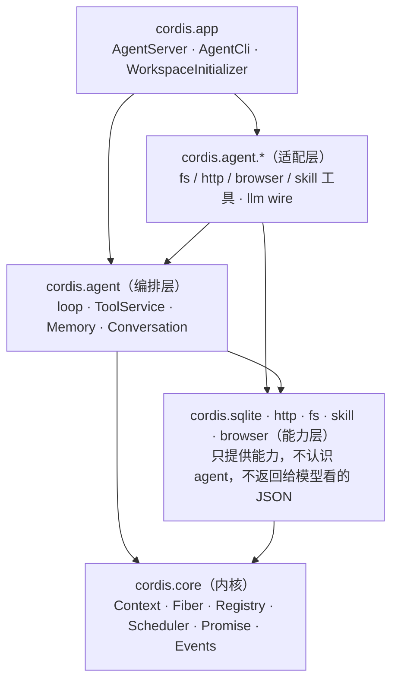
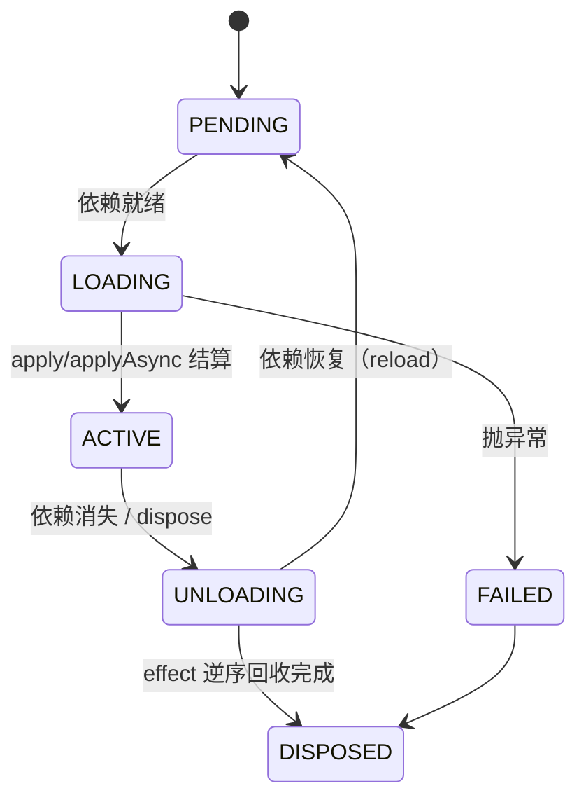

# cordis-java

[cordis](https://github.com/cordiverse/cordis)（TypeScript 的依赖注入 / 插件框架）核心部分的 **Java 8 移植**，并在其上长出一套可运行的 agent 基础设施：文件系统、SQLite、HTTP、SSE、技能（skill）、无头浏览器、模型工具调用循环，以及一个能直接起服务的 `AgentServer`。

- 语言的差别被如实承认：TS 用 Proxy 隐式解析服务，这里改成显式 `ctx.get(name)`；TS 用 `Promise` 表达一切，这里造了一个绑定主循环的 `Promise`/`Deferred`。
- 目标不是「语法翻译」，而是把 cordis 的**调度模型与生命周期语义**原样搬过来：主循环串行决策、阻塞工作 offload、依赖驱动挂载、effect 逆序回收、热插拔。
- 规模：107 个 Java 文件、约 1.5 万行，**运行时无框架依赖**（只有 6 个第三方库，见 [依赖](#依赖与版本选择)）。

---

## 目录

- [特性一览](#特性一览)
- [环境与构建](#环境与构建)
- [快速开始](#快速开始)
- [架构](#架构)
- [内核：cordis.core](#内核cordiscore)
- [能力层](#能力层)
- [Agent 层](#agent-层)
- [适配层与工具清单](#适配层与工具清单)
- [应用：AgentServer / AgentCli](#应用agentserver--agentcli)
- [线程模型与编码约定](#线程模型与编码约定)
- [日志](#日志)
- [安全模型](#安全模型)
- [验证与回归](#验证与回归)
- [已知限制](#已知限制)
- [目录结构与阅读顺序](#目录结构与阅读顺序)
- [依赖与版本选择](#依赖与版本选择)

---

## 特性一览

| 能力 | 实现要点 |
|---|---|
| 依赖注入 / 插件生命周期 | `Component` → `Fiber`（6 态状态机）→ `Registry`；依赖用 `inject` 声明，服务出现/消失自动挂载/卸载 |
| 异步调度 | 单线程主循环 + 扩展阻塞池（对应 JS 主线程 + libuv 线程池）；框架内部状态无锁 |
| 一等 Promise | 状态迁移与回调全在主循环，`fulfill/reject` 允许任意线程；`Deferred` 分离生产/消费 |
| 事件系统 | `emit / serial / bail / waterfall / parallel` 五种派发；监听器返回 Promise 自动进入异步链路；随 fiber 自动解绑 |
| 多租户隔离 | `ctx.isolate(name)` 生成隔离标签，同名服务在分支间互不可见 |
| 文件系统 | 沙箱（词法 + 真实路径双校验）、写前审批、大小上限、原子写、grep |
| SQLite | 两段式异步初始化（建连 offload → 主循环登记）、事务、参数化查询 |
| HTTP / SSE | OkHttp `enqueue` 桥接 Promise；增量 SSE 解析；重定向逐跳白名单校验 |
| 技能 | 目录扫描 → 清单进 system、正文按窗口续读（省 token） |
| 无头浏览器 | Playwright 1.65 + 无障碍树 `[ref=eN]` + `getByRef`，模型不写 CSS 选择器 |
| Agent loop | 多轮工具调用、工具并发池、工具热插拔、可取消、事件流 |
| 记忆 | SQLite 持久化、`seq` 数据库侧原子分配、轮次事务、残缺配对自修复 |
| 服务化 | `AgentServer`（HTTP + SSE）+ `AgentCli`（控制台客户端），默认只读、不联网、不装浏览器 |

---

## 环境与构建

- **JDK 8+**（`maven.compiler.source/target = 1.8`，全部代码可在 JDK 8 编译）
- **Maven 3.6+**

```bash
# 编译
mvn compile

# 生成运行期 classpath（后面所有 java -cp 都用它）
mvn dependency:build-classpath -Dmdep.outputFile=target/cp.txt

# 之后统一用：
CP="target/classes:$(cat target/cp.txt)"
```

> 依赖已在本地仓库时加 `-o` 走离线解析，速度更快；首次拉取（尤其 218MB 的 Playwright 驱动）需要联网。

> Playwright 会引入 **218MB** 的 `driver-bundle` jar（229 MB 十进制），首次解析依赖会明显变慢；它只服务 `cordis.browser`，不参与内核。

---

## 快速开始

### 1. 跑一个最小生命周期 demo

```bash
java -cp "$CP" cordis.demo.LifecycleDemo
```

它演示：根上下文、慢初始化插件 `applyAsync` offload、fiber 停在 `LOADING` 期间主循环照常挂载其他插件、`Promise.all` 等全部就绪、卸载时 effect 逆序回收。

### 2. 起一个能对话的 agent 服务

凭证只从环境变量读（公司 AIGC 网关，OpenAI 兼容）：

```bash
export MT_AIGC_APP_ID=<你的 AppId>     # 必填
export MT_AIGC_MODEL=LongCat-Flash-Chat # 可选
# export MT_AIGC_BASE_URL=...            # 可选，默认 https://aigc.sankuai.com/v1/openai/native

java -cp "$CP" cordis.app.AgentServer --port 8787 --root ~/agent-ws --allow-write
```

另开一个终端：

```bash
java -cp "$CP" cordis.app.AgentCli            # 默认走 SSE，逐轮打印
```

或者直接 curl：

```bash
curl -s -X POST http://127.0.0.1:8787/chat \
  -H 'Content-Type: application/json' \
  -d '{"message":"看一下工作区有哪些文件"}' | python3 -m json.tool
```

### 3. 在自己的代码里装配

```java
Context root = Context.root();   // 自带 Scheduler：cordis-main-loop + cordis-worker

// 能力：SQLite + 文件系统（写操作默认拒绝，必须显式给 ApprovalGate）
root.registry.use(SqlitePlugin.INSTANCE, Maps.of("url", "jdbc:sqlite::memory:"), null);
root.registry.use(FileSystemPlugin.INSTANCE, Maps.of(
        "root", "/tmp/agent-ws",
        "approval", (ApprovalGate) request -> true), null);   // 生产环境换真实审批

// agent：需要一个 LlmClient 实现
root.registry.use(AgentPlugin.INSTANCE, Maps.of(
        "llm", new OpenAiLlmClient(...),
        "maxSteps", 8,
        "system", "你是一个谨慎的助手"), null);

// 工具：一个工具 = 一个 fiber，dispose 即下线
root.registry.use(FileSystemTools.INSTANCE, Maps.of(),
        Maps.of("filesystem", true, "agent.tools", true));
root.registry.use(new ToolComponent(new MyTool()), Maps.of(),
        Maps.of("agent.tools", true));                        // 自定义工具同理

// 等全部就绪后直接跑 loop
AgentService agent = root.get("agent");
AgentResult result = agent.run(Collections.emptyList(), "读一下 README.md").completion().join();
```

> `cordis.agent.fs` 里的具体工具类（`ReadFileTool` 等）是包私有的，统一由
> `FileSystemTools` 注册；要加自己的工具，实现 `Tool` 再包一层 `ToolComponent`。

---

## 架构

三层，依赖方向单一，越往下越不知道「上层」存在：



关键分界线：

- **能力层不知道 agent**：`FileSystemService` 返回 `FileEntry` / `FileSlice`，不是 JSON；`BrowserService` 返回 `PageSnapshot`，不是 tool result。给模型看的 schema、参数解析、结果塑形全在适配层。
- **wire 协议不进框架**：Jackson 只出现在 `cordis.agent.llm`（OpenAI 兼容协议）和适配层的 `JsonCodec`，内核与 `cordis.agent` 不依赖 JSON 库。
- **能力可以单独用**：不用 agent 也能直接 `ctx.get("filesystem").readSync(...)`、`ctx.get("browser").openSync(...)`。

### 包结构

| 包 | 角色 | 主要类 |
|---|---|---|
| `cordis.core` | 内核 | `Context` `Fiber` `Registry` `Scheduler` `Promise` `Deferred` `EventsService` `Service` `Component` |
| `cordis.sqlite` | 能力 | `SqliteService` `SqlitePlugin` |
| `cordis.http` | 能力 | `HttpService` `HttpPlugin` `SseParser` `SseCall` `HttpAccessPolicy` |
| `cordis.fs` | 能力 | `FileSystemService` `FileSystemPlugin` `PathScope` `ApprovalGate` |
| `cordis.skill` | 能力 | `SkillService` `SkillPlugin` `Skill` |
| `cordis.browser` | 能力 | `BrowserService` `BrowserPlugin` `PageSnapshot` |
| `cordis.agent` | 编排 | `AgentService` `ToolService` `ConversationService` `MemoryService` + 三个插件 |
| `cordis.agent.llm` | wire | `OpenAiLlmClient` |
| `cordis.agent.fs / http / browser / skill` | 适配 | 各工具类 + `*Tools` 组件 |
| `cordis.app` | 应用 | `AgentServer` `AgentCli` `WorkspaceInitializer` |
| `cordis.demo` | 验证 | 14 个可执行 demo，见 [验证与回归](#验证与回归) |

---

## 内核：cordis.core

### Context：extend 树 + 隔离标签

```java
Context root = Context.root();
Context child = root.extend();          // 子上下文（对应 Object.create 原型链）
Context t1 = root.isolate("database"); // 为 "database" 生成新标签，遮蔽父链
root.get("sqlite");                     // 显式解析（Java 没有 Proxy）
```

- 服务仓库挂在根上下文，**以隔离标签为主键**：默认所有分支共享同一标签，兄弟插件可以互相解析。
- `isolate(name)` 之后，该分支里 `provide/get` 都走新标签，与外界同名服务互不可见 —— 这是 `TenantDemo` 验证的多租户基础。
- 内部表用 `ConcurrentHashMap`：写入只在主循环，但 `get` 允许任意线程调用（实测普通 `HashMap` 在扩容窗口会漏读，表现为「服务时有时无」）。

### Fiber：6 态状态机 + effect



- **依赖驱动**：`use(component, config, inject)` 里声明的服务全部就绪才进 `apply`；任一消失就回 `PENDING`。装配顺序无关紧要。
- **effect**：插件运行期注册的一切（事件监听、服务注册、工具注册、连接）都挂在 fiber 上，卸载时**逆序**执行清理。`ctx.on(...)`、`tools.add(...)` 都返回 `Disposable`，交给 fiber 持有。
- **异步初始化**：插件可实现 `applyAsync` 返回 `Promise<Disposable>`，期间 fiber 停在 `LOADING`，主循环不被阻塞。`SqlitePlugin` / `FileSystemPlugin` / `SkillPlugin` / `MemoryPlugin` 都是这个套路。

### Scheduler：主循环 + 扩展池

| 线程 | 数量 | 职责 |
|---|---|---|
| `cordis-main-loop` | 1 | 所有状态迁移、事件派发、Promise 回调、`provide`/`get` 的写侧 |
| `cordis-worker` | `max(4, cores)` | JDBC、文件、HTTP、浏览器、重计算等一切阻塞工作 |

```java
scheduler.execute(task);        // 投递到主循环（已在主循环则内联执行）
scheduler.executeLater(task);   // 推迟一拍（避免「字段还没赋完就广播」）
scheduler.offload(callable);    // 投递到扩展池，返回 Promise
scheduler.defer();              // 拿 Deferred（生产方）
scheduler.awaitIdle();          // 主循环屏障，测试/编排用
scheduler.shutdown();           // 优雅关闭：扩展池 5s、主循环 1s 后再中断
```

**铁律**：主循环上只允许微秒级决策。任何可能阻塞的操作必须 `offload`。`*Sync` 方法（`readSync`、`openSync`、`listSync`…）内部会 `assertNotMainLoop`，在主循环调用直接抛错 —— 这不是洁癖，是为了让「不小心在事件监听器里读文件」立刻炸掉，而不是悄悄卡死整个框架。

### Promise / Deferred

```java
Deferred<String> d = scheduler.defer();
Promise<String> p = d.promise();   // 消费方只读视图
p.then(s -> ...).catchError(e -> ...);
d.resolve("ok");                   // 任意线程可调，内部投递回主循环
```

- 单线程完成语义：回调之间永无并发。
- `join()` 是唯一阻塞入口，只给编排层和测试用；框架内部从不调用（主循环上 `join` 会自死锁，有 fail-fast 保护）。
- 组合子：`then` / `thenAsync` / `catchError` / `handle` / `all` / `allSettled`。

### EventsService

```java
ctx.on("agent/tool", args -> { ... });          // 随 fiber 自动解绑
ctx.events.emit("agent/reply", reply);           // 任意线程可调
ctx.events.waterfall("system/prompt", base, ...);// 监听器可改写值
ctx.events.parallel("cleanup", ...);             // 收集所有异常
```

五种模式：`emit`（同步广播）、`serial`（依次等待）、`bail`（首个非 undefined 即停）、`waterfall`（管道改写）、`parallel`（并发收集异常）。监听器返回 `Promise` 时自动进入异步链路。

### Service / Component

```java
// 服务：构造即注册（对应 TS 构造函数里的 reflect.provide）
public class MyService extends Service {
    public MyService(Context ctx) { super(ctx, "my.service"); }
}

// 组件：定义（一份定义 → 档案 Runtime → 任意多 fiber）
public class MyPlugin implements Component {
    public String getName() { return "my-plugin"; }
    public Disposable apply(Context ctx, Map<String, Object> config) {
        ctx.on("some/event", args -> { ... });
        return () -> { /* 清理，卸载时执行 */ };
    }
}
```

`Component.named(name, lambda)` 可给匿名组件起名；`ToolComponent` 演示了「一个工具 = 一个组件」。

---

## 能力层

### SQLite —— 两段式异步初始化的范本

```java
root.registry.use(SqlitePlugin.INSTANCE, Maps.of("url", "jdbc:sqlite:/tmp/app.db"), null);
SqliteService db = root.get("sqlite");

db.execute("INSERT INTO t(a) VALUES(?)", 42);       // 阻塞方法，须在 worker 上调用
List<Map<String, Object>> rows = db.query("SELECT * FROM t");
db.transaction(() -> { ... });                      // 失败自动回滚 + 复原 auto-commit
```

插件实现 `applyAsync`：`DriverManager.getConnection` offload 到扩展池 → 回主循环 `new SqliteService(...)`（`provide` 必须主循环）→ ping 自检再 offload。慢初始化期间主循环零阻塞。

### HTTP / SSE

```java
HttpService http = root.get("http");
http.get("https://example.com").then(res -> res.body);
http.postJson(url, json).then(res -> res.status);

// SSE：逐事件回调，零阻塞
SseCall call = http.stream(request, event -> { ... });
call.dispose();     // 或等 call.completion()
```

- 走 OkHttp `enqueue` 原生异步，不占扩展池（与 JDBC 的 offload 形成对照）。
- `SseParser` 是逐行增量状态机：空行派发、`:` 注释忽略、多行 `data` 拼接、无 data 不派发。
- `HttpAccessPolicy` 是「模型能访问哪些地址」的关口，默认 deny-all；`HttpCaller` 对**每一跳重定向**重新校验，堵住「白名单地址 302 到内网」。

### 文件系统

```java
FileSystemService fs = root.get("filesystem");
fs.readSync("src/Main.java", 1, 200);
fs.writeSync("notes.md", "# hi");        // 过 ApprovalGate 才落盘
fs.grepSync("TODO", "*.java");
```

安全模型四层：

1. **沙箱**：`PathScope` 先做词法校验（`normalize` 后必须仍在 root 内，绝对路径与 `../` 当场打回），再对已存在部分做 `toRealPath()` 比对（挡符号链接逃逸）。
2. **审批**：写/改之前过 `ApprovalGate`，默认拒绝一切。
3. **上限**：`maxReadBytes`（2MB）/ `maxWriteBytes`（1MB），先量再动。
4. **原子写**：写同目录临时文件再 `ATOMIC_MOVE`，中途被杀不会留下半个目标文件。

二进制文件（前 8KB 含 NUL）直接拒绝，避免把字节流当 UTF-8 解码再写回去。

### 技能（skill）

```
<skills>/
  markdown-writer/
    skill.json     ← {"description": "..."}，可缺省
    SKILL.md       ← 正文（按需加载）
    references/    ← 二级资源
```

- **清单**（名字 + 一句话描述）拼进 system，常驻但很小；**正文**按窗口续读（`bodySync(name, offset)`），不一次性塞满上下文。
- skill 目录的增删改不自动生效，重装 `SkillPlugin`（fiber reload 即重扫）后才反映 —— 复用框架的热插拔，而不是额外做文件监听。

### 无头浏览器

```java
BrowserService browser = root.get("browser");
PageSnapshot snap = browser.openSync("https://www.sogou.com/", 800);
// snap.snapshot 里是带 [ref=e12] 的无障碍树
browser.typeSync(snap.pageId, "e4", "北京天气", true);
PageSnapshot after = browser.snapshotSync(snap.pageId);   // 每次操作后重新取快照，旧 ref 可能失效
browser.screenshotSync(snap.pageId);
browser.closeSync(snap.pageId);
```

设计要点：

| 决策 | 原因 |
|---|---|
| `ariaSnapshot(mode=AI)` + `getByRef("e5")` | 快照几百字符（vs innerHTML 数万），模型不需要写 CSS 选择器；1.64+ 官方 agent 能力 |
| 一个页面 = 一个 `BrowserContext` | cookie / storage 天然隔离 |
| 每页一把 `ReentrantLock` | Playwright `Page` 非线程安全 |
| 只校验 main frame 导航 + 重定向后 final URL | 浏览器自己会发 XHR，子请求无法逐个白名单 |
| 拒绝 `file://` / `data:` | `file://` 能读本机任意文件 |
| 懒启动 + 插件异步预热 | 首次 `create` 8.9s + `launch` 3.7~4.3s，预热后首个工具调用不必等 |
| `channel=chrome` + 自动注入 `PLAYWRIGHT_SKIP_BROWSER_DOWNLOAD=1` | 用系统 Chrome，省一套 chromium + headless_shell 的 583MB 下载（实测）；机器上没 Chrome 时明确报错而不是偷偷下载 |

---

## Agent 层

### AgentService：loop 本体

```
user input
  └─ for step in 1..maxSteps:
       工具快照 → llm.chat(历史, 快照)
         ├─ 无 toolCalls → emit(reply) → AgentResult(ANSWERED)
         └─ 并发执行本轮全部工具 → 结果回填历史 → 下一轮
```

- 整个 loop 跑在**扩展池的一个 worker** 上：模型调用与工具执行都在那里同步进行，主循环全程不被触碰。
- 工具并发用 `AgentService` **自带的**小线程池，不是 `scheduler.offload`：自己已占一个 worker，再从 worker offload 并等回来会在整池等子任务时自锁。
- 事件：`agent/step`、`agent/reply`、`agent/tool`，监听器可拿到本次 run 的 `AgentListener`。
- 取消粒度是「轮」：`AgentCall.dispose()` 后下一轮不再开始，已产生的消息仍落库。

### ToolService 与工具热插拔

```java
ToolService tools = root.get("agent.tools");
Disposable reg = tools.add(new MyTool());   // 注册
reg.dispose();                              // 下线，AgentService 下一轮快照里消失
```

`add` 返回的 `Disposable` 通常由 `ToolComponent` 交给 fiber 当 effect 持有，于是「一个工具 = 一个 fiber」：热卸载 / 重装完全复用生命周期模型。

### MemoryService

```sql
sessions(id TEXT PK, created_at INTEGER, updated_at INTEGER)
messages(id INTEGER PK AUTOINCREMENT, session_id TEXT, seq INTEGER,
         role TEXT, content TEXT, tool_calls TEXT, tool_call_id TEXT, created_at INTEGER,
         UNIQUE(session_id, seq))
```

- `seq` 由单条 `INSERT ... SELECT COALESCE(MAX(seq),0)+1` 在数据库侧原子分配，并发追加不会重号。
- 一轮对话的多条消息用事务包起来；`loadSync` 发现尾部残缺配对（有 `tool_calls` 没有 `tool` 结果）会截断并 emit `memory/repaired`。

### ConversationService：一次调用串起三段

```java
ConversationService conv = root.get("conversation");
conv.send("user-42", "我叫小明").completion().join();
```

`load → loop → save` 在同一个 worker 上顺序执行（省一个 worker，也避免同一会话的读写在两个 worker 上交错）。落库失败不影响答案，只 emit `conversation/persist-error`。

### OpenAiLlmClient：流式聚合

SSE 的 `delta.tool_calls` 分片先经 `ToolCallAggregator` 归并成完整 `ToolCall`，再返回给 loop —— loop 对「流式与否」无感知。同时把「先说话再调工具」的文本保留在历史里。

---

## 适配层与工具清单

所有工具都是「能力层的一层薄壳」：解析参数 → 调 `*Sync` 方法 → 塑形 JSON。`Tool.run` 本来就跑在 worker / toolPool 上，所以不用再 offload 一次。

| 工具 | 所属组件 | 需要能力 | 作用 |
|---|---|---|---|
| `list_dir` `read_file` `write_file` `edit_file` `grep` | `agent.fs` | `filesystem` | 沙箱内读写、按行读、精确替换、正则搜索 |
| `http_get` `http_post` | `agent.http` | `http` | 过白名单的 HTTP 调用，重定向逐跳校验 |
| `browser_open` `browser_snapshot` `browser_click` `browser_type` `browser_press` `browser_wait` `browser_screenshot` `browser_close` | `agent.browser` | `browser` | 打开页面、取快照、按 `ref` 点击/输入/按键、等待、截图、关页 |
| `use_skill` | `agent.skill` | `skills` | 按名字加载技能正文（清单由 `SystemProvider` 拼进 system） |

装配模式统一：

```java
root.registry.use(FileSystemTools.INSTANCE, Maps.of(),
        Maps.of("filesystem", true, "agent.tools", true));
root.registry.use(HttpTools.INSTANCE, Maps.of("policy", policy),
        Maps.of("http", true, "agent.tools", true));
root.registry.use(BrowserTools.INSTANCE, Maps.of(),
        Maps.of("browser", true, "agent.tools", true));
root.registry.use(SkillTools.INSTANCE, Maps.of(),
        Maps.of("skills", true, "agent.tools", true));
```

`inject` 决定两件事：依赖未就绪时 fiber 停在 `PENDING`；`apply` 里 `ctx.get(...)` 必然拿得到（提供者已 ACTIVE）。缺任何一项都会抛可定位的错误，而不是 NPE。

---

## 应用：AgentServer / AgentCli

### 启动

```bash
export MT_AIGC_APP_ID=<AppId>
java -cp "$CP" cordis.app.AgentServer [选项]
```

| 参数 | 默认 | 说明 |
|---|---|---|
| `--port` | 8787 | `0` = 系统分配 |
| `--bind` | 127.0.0.1 | 绑定地址 |
| `--root` | `./agent-workspace` | 工作区（文件系统沙箱边界） |
| `--skills` | `<root>/skills` | 技能目录 |
| `--allow-write` | 关 | 不加则写操作全部被拒 |
| `--allow-host <h>` | 无 | HTTP 白名单，可重复；`'*'` 全开（仅本地调试）。不写则不装 http 工具 |
| `--enable-browser` | 关 | 装 `browser_*` 八个工具，导航闸门复用 `--allow-host` |
| `--browser-channel` | `chrome` | 系统 Chrome；`''` 用 Playwright 自带二进制 |
| `--browser-headful` | 无头 | 有界面启动，便于观察 |
| `--max-steps` `--max-sessions` `--model` `--base-url` | — | 见 `--help` |

### 接口

| 方法 | 路径 | 说明 |
|---|---|---|
| GET | `/health` | 模型、可见工具、技能数、写入策略、会话数、`http`/`httpScope`、`browser`/`browserScope`/`browserPages` |
| POST | `/chat` | `{"session":"可选","message":"...","stream":false}` → `{"session","answer","stopReason","steps","toolCalls","elapsedMs","events"}` |
| POST | `/chat` | 加 `"stream":true` 或 `Accept: text/event-stream` → 逐帧 `data: {"type":...}` |
| POST | `/reset` | `{"session":"..."}` 清空该会话历史 |

SSE 帧类型：`step`（进入第 n 轮，带当前工具快照）、`tool_start`、`tool`（工具结果）、`final`、`error`。

### 并发模型

锁只护住单个会话的 `history`：同一会话串行、不同会话真并发。过程事件走每次 run 独立的 `AgentListener`，天然按次隔离，不需要全局串行。

### AgentCli

```bash
java -cp "$CP" cordis.app.AgentCli [url] [--no-stream] [--session id]
```

默认读 SSE 逐帧打印；`--no-stream` 退回一次性 JSON；内置 `/help` `/health` `/reset` `/exit`。

---

## 线程模型与编码约定

写插件时只需要记住四条：

1. **主循环只做决策**。可能阻塞的事情一律 `scheduler.offload(...)`，或像 `HttpService` 那样用原生异步回调。
2. **`Service` 构造必须在主循环**（`ctx.provide` 会断言）。因此 `applyAsync` 的模式永远是「扩展池准备 → `then` 回主循环构造」。
3. **`*Sync` 只能在 worker 上调用**。在主循环调用会 fail-fast；这条规则让「顺手在监听器里读文件」变成显式错误。
4. **清理逻辑交给 effect**。`apply` 返回的 `Disposable` 与 `ctx.on(...)` 的返回值都会被 fiber 逆序回收，不要在插件里另建生命周期管理。

---

## 日志

分界只有一条：**程序的产物走命令行，运行期事件走 slf4j**。

| 输出者 | 通道 | 理由 |
|---|---|---|
| `cordis.demo.*` 的断言与演示 | `System.out` / `System.err` | 格式即契约：`java -cp ... Demo && echo ok`，`[PASS]`/`[FAIL]` 被脚本 grep |
| `AgentCli` | `System.out` | 它本身就是交互式 UI |
| `AgentServer` 的 `--help`、启动 banner | `System.out` | 一次性、人读、面向控制台 |
| `AgentServer` 参数错误 / 启动失败 | `System.err` + 非 0 退出码 | 让 `./server --bad` 在 shell 里失败 |
| 框架运行期（`core` / 能力层 / `agent` / `app` 请求处理） | slf4j | 目标、级别、格式应由装配方决定，库无权写死 stdout |

框架代码只依赖 `slf4j-api`（编译期），`slf4j-simple` 只是 `runtime` 便利 binding；换 logback / log4j2 / jul 只需替换它，业务代码零改动。

`slf4j-simple` 默认 INFO 且不带时间戳，生产建议：

```bash
java -Dorg.slf4j.simpleLogger.showDateTime=true \
     -Dorg.slf4j.simpleLogger.dateTimeFormat='yyyy-MM-dd HH:mm:ss.SSS' \
     -cp "$CP" cordis.app.AgentServer
```

级别约定：

| 级别 | 用在 |
|---|---|
| ERROR | 框架内部不可恢复：主循环任务抛出、fiber 挂载/卸载失败、`handle` 之外必须留痕的异常 |
| WARN | 降级但继续：监听器抛错、事务回滚/复原失败、HTTP 500、浏览器预热失败 |
| INFO | 一次性生命周期事实：workspace 就绪、技能数、driver 启动与耗时、浏览器预热完成 |
| DEBUG | 高频或纯诊断：连接建立、临时文件清理失败、driver 关闭 |

---

## 安全模型

默认值一律是「关」，需要显式打开：

| 关口 | 默认 | 打开方式 |
|---|---|---|
| 文件写入 | 拒绝一切 | `--allow-write`，或装配时传 `(ApprovalGate) request -> true` |
| 文件读取范围 | 工作区沙箱 | `FileSystemPlugin` 的 `root` |
| HTTP 出网 | 不装工具 | `--allow-host` / `HttpTools` 的 `policy` |
| 浏览器导航 | 不装工具；装了也是 deny-all | `--enable-browser` + `--allow-host` |
| 浏览本机文件 | 永远拒绝 | `file://` / `data:` 直接打回 |

设计取舍：**能自拟 URL 的模型 = 内网访问权**，所以网络能力默认不存在，而不是「有但受限」。三道关口（fs / http / browser）互相独立，可以只开一道。

---

## 验证与回归

全部 demo 都是 `main` 方法 + 断言，不需要测试框架：

```bash
CP="target/classes:$(cat target/cp.txt)"
for d in LifecycleDemo TenantDemo HttpDemo SqliteDemo SseDemo AgentDemo MemoryDemo \
         AgentHardeningDemo FsAgentDemo SkillAgentDemo AgentServerDemo HttpToolDemo BrowserToolDemo; do
  java -cp "$CP" cordis.demo.$d > /dev/null 2>&1 && echo "$d ok" || echo "$d FAILED"
done
```

| Demo | 验证内容 |
|---|---|
| `LifecycleDemo` | 异步调度、慢初始化不阻塞、依赖驱动挂载、effect 逆序回收 |
| `TenantDemo` | `isolate` 分支隔离、同名服务互不可见、分支卸载不污染其他租户 |
| `SqliteDemo` | 两段式初始化、依赖先后无关、参数化查询、事务 |
| `HttpDemo` | OkHttp 并发（10×200ms 总耗时接近单次）、超时、错误码 |
| `SseDemo` | SSE 逐事件、主循环零阻塞、主动取消、错误路径 |
| `AgentDemo` | 脚本 LLM 打通 loop、工具热插拔、取消、流式分片聚合 |
| `MemoryDemo` | 对话落库、业务插件重装后历史仍在、`tool_calls` 往返无损 |
| `AgentHardeningDemo` | 工具异常回填合法 JSON、轮次事务、残缺配对自修复 |
| `FsAgentDemo` | 沙箱/审批/大小上限 + 真实模型「读 → 改 → 再读」（section 3 缺 `MT_AIGC_APP_ID` 自动跳过） |
| `SkillAgentDemo` | 扫描、清单、窗口续读 + 「清单 → 挑一个 → 加载正文 → 读资源」（section 3 同上自动跳过） |
| `AgentServerDemo` | `/health` 三态、流式与双会话并发不串台、浏览器工具装配四态（5+3+4 条） |
| `HttpToolDemo` | 13 条断言，覆盖白名单、`*` 全开、重定向逐跳、截断、二进制、POST 回显、热插拔 |
| `BrowserToolDemo` | 13 条断言，覆盖本地表单页 open→ref→type→click→读 JS 结果、异步等待、截图、`file://` 与白名单拒绝、多页隔离 |
| `OpenAiAgentDemo` | 真实模型（需 `MT_AIGC_APP_ID`）：多步 loop、流式与非流式对拍 |

实测参考：Playwright 首次 `create` 8875ms、`launch` 3674~4302ms、`navigate` 913~4095ms；`channel=chrome` 在空的 `PLAYWRIGHT_BROWSERS_PATH` 下仍可用（Chrome 158）。

---

## 已知限制

- **未移植 `symbols.intercept`**：TS 用它「在本分支覆盖某服务配置」，本范例没有服务消费它，故不提供看起来生效、实际没人读的半成品 API。
- **同一 session 的并发 `send` 未串行化**：`seq` 不会重复（数据库侧原子），但对话语义会交错。需要严格串行时调用方按 sessionId 加锁。
- **skill 变更需重装插件**：没有文件监听，重扫靠 fiber reload。
- **浏览器反爬是事实**：百度 `/s?wd=` 会返回「百度安全验证」或导航超时；搜狗可用。结构化数据（天气等）应走官方 API，浏览器留给真要跑 JS 的页面。
- **Playwright 体积**：`driver-bundle` 218MB，别打进 fat jar；生产镜像预装浏览器并设 `PLAYWRIGHT_SKIP_BROWSER_DOWNLOAD=1`。
- **无 JUnit**：验证方式是 demo 里的断言，没有 CI 集成；需要时可在 pom 里加 surefire + JUnit 4。

---

## 目录结构与阅读顺序

```
src/main/java/cordis/
  core/      ← 先读：Context → Fiber → Scheduler → Promise → EventsService
  sqlite/    ← applyAsync 两段式的最短范例
  http/      ← 原生异步桥接 + SSE + 白名单
  fs/        ← 沙箱与审批
  skill/     ← 清单/正文分离
  browser/   ← Playwright 封装
  agent/     ← loop、工具、记忆、会话
  agent/*/   ← 工具适配层（薄壳）
  app/       ← AgentServer / AgentCli
  demo/      ← 每个能力都有可执行的断言
```

建议顺序：`LifecycleDemo` → `core` 五个类 → `SqliteDemo` + `SqlitePlugin` → `HttpDemo` → `AgentDemo` → `AgentServer`。

---

## 依赖与版本选择

| 依赖 | 版本 | 为什么是这个版本 |
|---|---|---|
| JDK | 8 | 目标基线；`maven.compiler.source/target = 1.8` |
| `sqlite-jdbc` | 3.21.0.1 | 纯 Java、零本地库，内存库与文件库都能用 |
| `okhttp` | 3.14.9 | 4.x 起用 Kotlin 编写，会连带引入 `kotlin-stdlib`；本项目只需要 `enqueue` 异步回调 |
| `jackson-databind` | 2.17.2 | 只给 wire 层（OpenAI 兼容协议）用；2.17 是 Java 8 基线，3.x 要 JDK 17 |
| `playwright` | 1.65.1 | 官方主 pom 仍是 source/target 8；1.64+ 提供 `ariaSnapshot(AI)` 与 `getByRef` |
| `slf4j-api` | 2.0.17 | 日志门面，2.x 基线 Java 8；框架只依赖 API，不绑定实现 |
| `slf4j-simple` | 2.0.17 | `runtime` scope 的便利 binding（打 stderr），供 demo 与 AgentServer 直接运行；作为库引入时应换成自己的实现 |

内核除了 `slf4j-api` 不依赖任何第三方库：`cordis.core` 其余只用 JDK 的 `java.util.concurrent` 与函数式接口。
