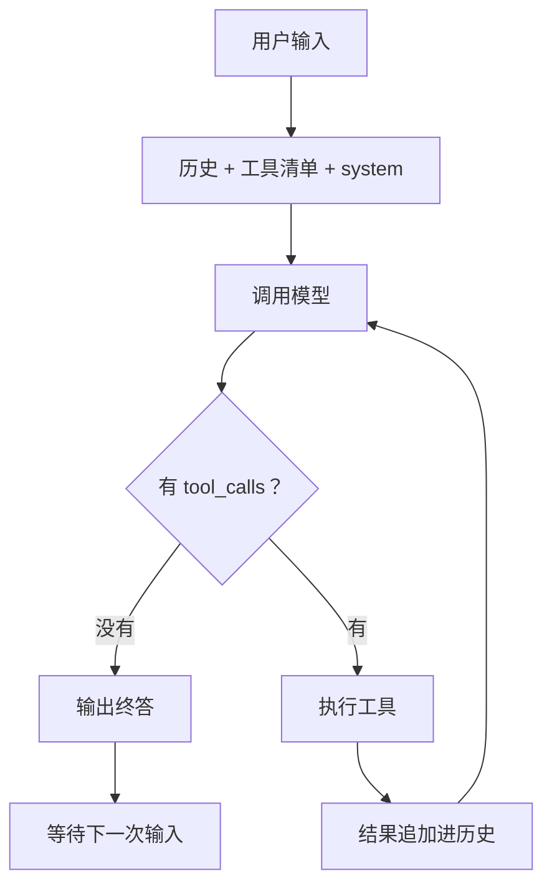

# 01 · 从一次模型调用到 Agent

## 1.1 一次调用的世界

先看最朴素的东西。一次 Chat Completions 调用是一个**纯函数**：

```
messages ──▶ 模型 ──▶ 一段文本
```

没有状态，没有副作用，没有记忆。你给什么它读什么，读完给一段话就结束。所有的"智能"都发生在这几百毫秒里，调用返回后一切归零。

这个模型能写代码、能分析数据、能解释概念，但它有四个天生的缺口：

| 缺口 | 表现 | 后果 |
|---|---|---|
| 不能行动 | 只能说"你可以运行 `ls` 看看" | 把工作推回给人 |
| 不能记忆 | 第二次调用不知道第一次说了什么 | 长任务需要人肉搬运上下文 |
| 不能纠错 | 答错了也照样输出完 | 一步错，后面全错 |
| 不知道边界 | 会自信地编造 | 用在工程上很危险 |

Agent 就是在这四个缺口上各补一块。补法很土，但有效：

- 不能行动 → **给它工具**，让它输出"我要调用什么"。
- 不能记忆 → **把历史存下来**，下次一起发过去。
- 不能纠错 → **循环**，让工具的真实结果回到下一轮输入。
- 不知道边界 → **权限**，默认什么都不许做。

## 1.2 关键认知：模型不执行任何东西

这是全书最重要的一句话，值得单独一节。

模型输出的 `tool_calls` 只是一段 JSON：

```json
{
  "id": "call_a1",
  "type": "function",
  "function": {
    "name": "read_file",
    "arguments": "{\"path\":\"README.md\",\"lines\":40}"
  }
}
```

它是**意图**，不是**事实**。文件没被读，命令没被跑，网络没被访问。真正去做事的是你写的宿主代码：解析 `arguments`、找到同名工具、调用它、把返回值塞回历史。

于是有一个推论：**模型能造成的破坏上限，等于你给了它哪些工具**。这句话在第十一章会变成一整套权限模型，但它从此刻开始就应该影响你的设计——如果你不想让模型删库，正确的做法不是"在提示词里求它别删"，而是"不实现删库工具"。

## 1.3 补上循环，就得到了 agent

把"模型决策 → 执行 → 结果回灌"接成一个环，agent 就出现了：



这个环叫 agent loop。它的最小实现只有二十行：

```java
history.add(LlmMessage.user(input));
for (int step = 1; step <= maxSteps; step++) {
    LlmReply reply = llm.chat(history, tools.snapshot(), system);
    history.add(LlmMessage.assistant(reply));

    if (!reply.hasToolCalls()) {
        return reply.content;              // 答完了
    }
    for (ToolCall call : reply.toolCalls) {
        String result = dispatch(call);    // 真的去执行
        history.add(LlmMessage.toolResult(call.id, result));
    }
}
return forcedSummary(history);             // 打满轮数，强制收尾
```

三行代码的差别，就是"聊天机器人"和"agent"的差别：

1. **模型的话要落进历史**，不只是展示给用户。
2. **工具真的被执行**，并且结果要能被模型读到。
3. **循环有上限**，否则一个执着的模型可以永远要工具。

## 1.4 从"能跑"到"能长期跑"

上面二十行能跑通一次演示。但只要你想把它放进一个真实服务里，立刻会撞上四个工程问题，而它们正好构成后面的全部章节：

**问题一：这些东西怎么装起来？**
文件系统、SQLite、HTTP、模型客户端、工具，各有各的初始化成本、依赖关系、失败可能。`new` 的顺序一旦写死，热插拔就没了。
→ **第二章：内核**（Context / Fiber / Registry）

**问题二：阻塞怎么办？**
模型调用几秒钟，JDBC 几十毫秒，页面渲染几秒钟。如果这些都在同一个线程上，整个服务就是串行的。
→ **第三章：主循环与扩展池**

**问题三：异步结果的落点在哪儿？**
"结果回来之后要做什么"必须有一个确定的目标。用裸线程回调，你会写出三层嵌套的 `synchronized`。
→ **第四章：Promise 与事件**

**问题四：上下文不够用怎么办？**
每一轮请求 = system + 全部历史 + 全部工具声明。工具返回的网页原文、文件全文会一轮一轮累加，很快把窗口撑爆。
→ **第十、十一章：预算与安全**

## 1.5 代价

这个架构换来的是"可运行的工程性"，代价也很明确，值得一开始就知道：

- **慢**。一次工具调用至少多花一个往返。能让模型一次答对的事，别做成两轮。
- **不确定**。同样的输入，模型可能选不同的工具。所有工具都必须假定"会被错误地调用"。
- **贵**。历史每轮重发，token 成本随轮次线性增长。
- **难调试**。出错时你看到的是一个错误的答案，不是一行报错。所以第十二章的观测和第十三章的回归测试不是可选项。

---

**下一章**：[02 · 为什么先要一个内核](02-kernel-why.md) —— 从"手写 new 的顺序"到"声明依赖、让框架决定顺序"。
