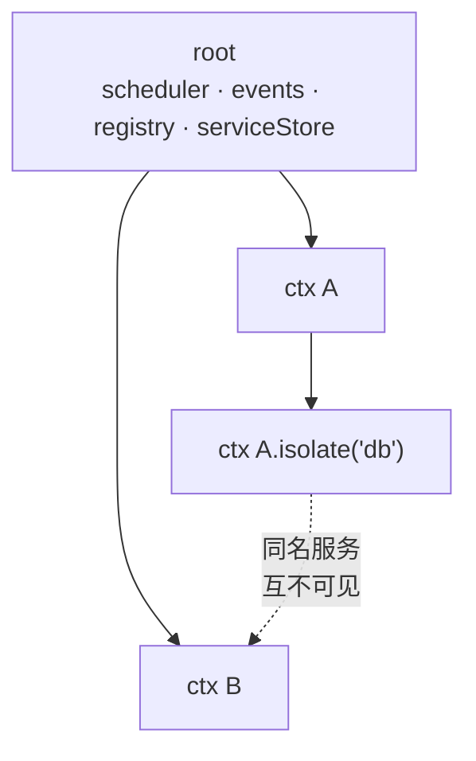
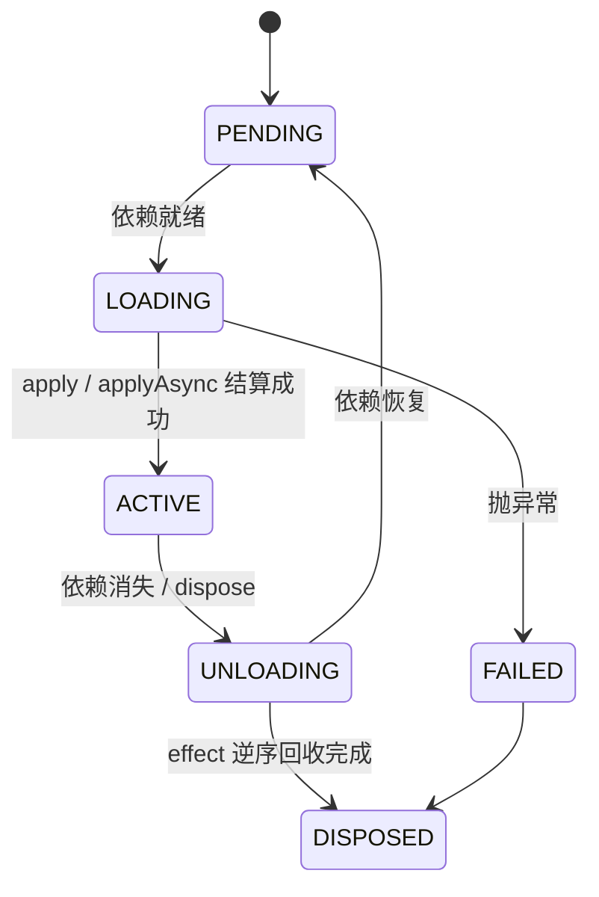
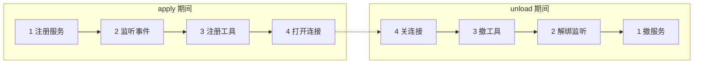

# 02 · 为什么先要一个内核

## 2.1 手写装配的三个死法

一个 agent 至少要装这些零件：

```
文件系统 · SQLite · HTTP · 浏览器 · 技能 · 工具表 · 模型客户端 · agent loop · 记忆 · 会话
```

最直觉的装法是：

```java
FileSystemService fs = new FileSystemService("/ws");
SqliteService db = new SqliteService("memory.db");
MemoryService memory = new MemoryService(db);
AgentService agent = new AgentService(llm, tools);
ToolService tools = new ToolService();          // ← 上一行就需要它了
```

这段代码会在三个地方死掉：

**死法一：顺序成了隐式契约。** 谁该在谁前面，只写在注释和"我记得"里。加一个插件，就得重新检查所有 `new` 的位置。

**死法二：失败无法回滚。** 建连到一半抛异常，前面已经打开的连接、已经注册的监听器怎么办？写在每个构造器里的 `try/catch` 很快就会互相纠缠。

**死法三：没有卸载这个概念。** agent 是长驻进程，你迟早需要"把这个工具下线"、"重扫技能目录"、"热更新模型配置"。而 `new` 出来的对象没有生命周期，只有 GC。

cordis 的答案是把这三件事抽象出来：**一份定义（Component）→ 一个生命周期容器（Fiber）→ 一个装配入口（Registry）**，服务解析交给 **Context**。

## 2.2 Context：服务的解析路径

Context 是一棵沿父链生长的树，每个节点持有一张"隔离标签表"。



`ctx.get("filesystem")` 做的事情只有三步：

1. 沿父链找到 `filesystem` 这个名字对应的**隔离标签**（没有就用根上登记的默认标签）；
2. 用标签去全局仓库取服务实例；
3. 检查提供者 fiber 是否 `ACTIVE`，再检查 `applicable(this)` 是否允许本上下文看见它。

第三点是全篇最容易被忽略、却最关键的一条：**`get` 会返回 null**。不是抛异常，不是返回一个半初始化的对象——服务不存在、提供者还没加载完、被隔离视图挡住，一律返回 null。调用方必须处理。

为什么要这么设计？因为"服务不存在"在插件系统里是**正常状态**，不是错误。文件系统插件慢初始化期间，工具插件应该安静地等着，而不是崩掉。等到文件系统 ACTIVE，它自然会被唤醒（见 2.4）。

> 工程细节：`serviceStore` 用 `ConcurrentHashMap`。写入只发生在主循环，但 `get` 允许任意线程调用。用普通 `HashMap` 时，扩容窗口里会读到 null，表现为"服务时有时无、依赖者被莫名卸载"。

## 2.3 Fiber：一个插件实例的生命周期

`Component` 是定义，可以理解成"类"；`Fiber` 是某次 `use()` 产生的实例，可以理解成"对象"。一个定义可以产生任意多根 fiber。

Fiber 是一个六态状态机：



它维护三样东西：

1. **状态**——上面这张图；
2. **依赖清单 `inject`**——"我要用到哪些服务"；
3. **effect 列表**——"我运行期注册过哪些资源"。

### 依赖驱动：装配顺序不再重要

```java
root.registry.use(FileSystemTools.INSTANCE, Maps.of(),
        Maps.of("filesystem", true, "agent.tools", true));
```

第三个参数是 `inject`。它的语义是：`filesystem` 和 `agent.tools` 两个服务都可见时，才调用 `apply`。否则 fiber 停在 `PENDING`，什么都不做。

于是装配代码可以写成任何顺序。你在 `apply` 里 `ctx.get("filesystem")` 时，可以放心地不判空——因为 `inject` 已经保证提供者处于 `ACTIVE`。

这条规则的反面同样成立：**依赖消失，fiber 自动卸载**。把 sqlite 插件 dispose 掉，memory 会先卸载，依赖 memory 的会话服务再卸载，级联下去。`LifecycleDemo` 演示的就是这个：拆掉数据库，服务器插件自动下线；重新装上，它又自动回来。

### effect：一切注册都必须可撤销

插件在运行期干的事，本质都是"注册"：注册服务、注册监听器、注册工具、打开连接。每一样都需要一个对应的撤销动作。

cordis 的做法是：**注册即返回 `Disposable`，由 fiber 持有**。

```java
public Disposable apply(Context ctx, Map<String, Object> config) {
    ctx.on("some/event", args -> { ... });   // 返回 Disposable，fiber 自动持有
    return () -> { /* 关连接、清临时文件 */ }; // 也是 Disposable，卸载时执行
}
```

卸载时按**注册的逆序**执行：



逆序不是洁癖。打开连接依赖配置，撤销连接必须在撤服务之前；工具注册依赖 `agent.tools` 服务，撤工具必须在撤服务之前。正序清理会得到"服务已经没了，但工具还挂在一个空指针上"。

### 为什么服务构造必须在主循环

`Service` 的构造器里就调用了 `ctx.provide(...)`。这带来一个约束：**服务实例必须在主循环线程上创建**。因为 `provide` 会立刻影响其他 fiber 的可见性判断，而其他 fiber 的状态迁移也在主循环上。

所以你会看到 `SqlitePlugin` 这种写法：阻塞的建连在扩展池上做，**建连完成后再回主循环**构造 `SqliteService`。这不是绕，这是唯一正确的姿势。第五章会展开讲这个"两段式"。

## 2.4 Registry：定义 → 实例

Registry 只做一件事：把一个组件在某个上下文上 `use()` 一次，就登记一份档案、产生一根 fiber。

```java
Fiber fiber = root.registry.use(MyPlugin.INSTANCE,
        Maps.of("root", "/ws"),          // config
        Maps.of("filesystem", true));    // inject
fiber.await().join();                    // 等这次挂载结算
fiber.dispose();                         // 下线，effect 逆序回收
```

`use()` 是**可以立即返回**的：fiber 创建只动自己的新上下文，不碰共享表；档案登记和挂载被投递到主循环。所以你拿到的是一个 `PENDING` 状态的 fiber，用 `await()` 等它结算。

服务出现或消失时，Registry 遍历所有 fiber，只唤醒 `inject` 里声明了该服务的那些。这就是依赖驱动的全部实现。

## 2.5 这层内核给 agent 换来了什么

回到 agent。如果没有这套东西，你得自己解决：

| 问题 | 内核给的答案 |
|---|---|
| 模型客户端初始化要 3 秒，期间别的东西能不能先装 | `applyAsync`，fiber 停在 LOADING，主循环不阻塞 |
| 没配 HTTP 白名单时，http 工具就不该存在 | 不 `use()` 即可，模型看不到、也不占 system 预算 |
| 某个工具要热下线 | `fiber.dispose()`，下一轮快照里它就消失 |
| 技能目录改了 | 重装 SkillPlugin，reload 触发重扫 |
| 卸载时连接泄漏 | effect 逆序回收，连接关闭写在清理函数里 |
| 多租户要用不同的数据库 | `ctx.isolate("sqlite")`，同名服务互不可见 |

注意最后一行的性质：这些都不是"agent 的功能"，而是**生命周期模型顺带提供的能力**。`ToolService.add` 返回的 `Disposable` 交给 fiber 持有，于是"一个工具 = 一根 fiber"——热插拔完全免费，不需要任何额外的注册中心。

## 2.6 代码形状

组件是这么定义的：

```java
public final class ToolComponent implements Component {
    private final Tool tool;

    public Disposable apply(Context ctx, Map<String, Object> config) {
        ToolService tools = ctx.get("agent.tools");   // inject 已保证可用
        return tools.add(tool);                        // 返回 Disposable 由 fiber 持有
    }
}
```

服务是这么定义的——构造即注册：

```java
public final class ToolService extends Service {
    public ToolService(Context ctx) {
        super(ctx, "agent.tools");       // 这一行就是 provide
    }
}
```

一个是"我提供能力"，一个是"我消费能力"，都只依赖 `Context` 这个接口。它们互相不知道对方是谁、什么时候被装上的。

## 2.7 代价

- **比 `new` 难读**。要理解一段代码，得同时理解它的 `inject`、它的 fiber 状态、它注册了什么。规模小的时候这套东西是纯负担。
- **错误被推迟**。`get` 返回 null 而不是抛错，意味着问题可能在一个完全不相干的地方才暴露。缓解手段是 `inject` + `assertInMainLoop` 这类 fail-fast 断言。
- **调试需要看线程名**。fiber 状态机只在 `cordis-main-loop` 上迁移，查看线程名是排查问题的第一步。

如果只是写一个一次性脚本，这些全都不值。但如果你的 agent 要跑几个月、要热更新工具、要支持多个租户，那它们会在第二个星期就开始回本。

---

**下一章**：[03 · 主循环与扩展池](03-thread-model.md) —— 为什么整个框架敢不用锁。
