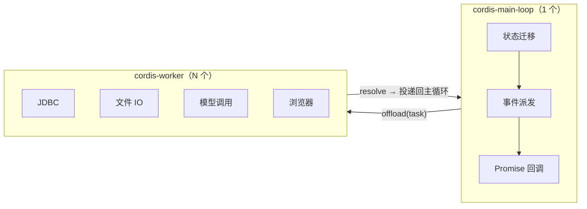

# 03 · 主循环与扩展池

## 3.1 移植的是调度模型，不是语法

cordis 的原始实现跑在 JavaScript 上。JS 有一个别人羡慕不来的特性：只有一条线程，所有回调天然串行，所以你写插件永远不用考虑 `synchronized`。

Java 没有这个特权。但如果你把"单线程串行"这件事**显式地建出来**，就能把那份无锁的简洁一起搬过来。这就是 `Scheduler`：

| 线程 | 数量 | 职责 |
|---|---|---|
| `cordis-main-loop` | 1 | 所有状态迁移、事件派发、Promise 回调、服务登记 |
| `cordis-worker` | `max(4, cores)` | JDBC、文件、HTTP、浏览器、重计算 |

这正好对应 JS 的"主线程 + libuv 线程池"。区别只是：JS 的线程池藏在 runtime 里，这里的线程池是你能看见、能投递任务的对象。



关键在最后那条箭头：**worker 上的结果不允许直接写框架状态**，必须经 Promise 回到主循环。所以 `serviceStore`、fiber 状态机、hooks 表全都只在一条线程上被写。一整框架没有一把业务锁，原因就在这里。

## 3.2 三条铁律

### 铁律一：主循环上只做微秒级决策

任何可能阻塞的操作，必须 `offload`：

```java
// 对：阻塞建连丢给 worker，回调回主循环继续
return ctx.scheduler.<Connection>offload(() -> DriverManager.getConnection(url))
        .then(conn -> new SqliteService(ctx, url, conn));   // 这个 then 在主循环上
```

如果忘了会怎样？一条 `cordis-worker` 线程阻塞，框架还能跑；主循环阻塞，**所有** fiber 的状态迁移、所有事件派发、所有 Promise 回调全部停摆。看起来像"服务卡住了但没报错"，最难查的那种。

### 铁律二：Service 构造必须在主循环

因为构造器里就 `provide`，而 `provide` 会立刻改变其他 fiber 的可见性，并唤醒依赖者。这个动作必须和其他状态迁移串行。

`Context.provide` 里有一行 `scheduler.assertInMainLoop(...)`，就是为了让违规当场炸掉，而不是留下一个"偶尔有服务看不见"的幽灵 bug。

### 铁律三：`*Sync` 只能在 worker 上调用

能力层的同步方法（`readSync`、`openSync`、`listSync`、`bodySync`）都会检查当前线程：

```java
if (Thread.currentThread() == ctx.scheduler.mainLoopThread()) {
    throw new IllegalStateException("filesystem.readSync performs blocking IO "
            + "and must not run on the main loop");
}
```

这条断言的价值在于**把隐性错误变成显性错误**。"在事件监听器里读个文件"是一件非常自然、非常容易写出来的事，它会静默地把整个调度器拖住。有了断言，它变成一个立刻可定位的异常。

## 3.3 自锁陷阱：为什么 agent 有自带的线程池

这是全仓库最值得记住的一个坑。

`AgentService.run` 把自己整个 loop `offload` 到扩展池，占掉一个 worker。loop 内部需要**并发执行同一轮的多个工具调用**。直觉写法是：

```java
for (ToolCall call : requests) {
    futures.add(ctx.scheduler.offload(() -> dispatch(call)));   // 危险
}
```

问题：这段代码本身就跑在 worker 上，它在等自己刚提交出去的子任务。如果扩展池只有 4 个 worker，而同时有 4 个会话在跑 loop，四个父任务都在等子任务，池子满了，子任务排不上队——**死锁**。

所以 `AgentService` 自带一个小线程池：

```java
this.toolPool = Executors.newCachedThreadPool(r -> {
    Thread t = new Thread(r, "agent-tool");
    t.setDaemon(true);
    return t;
});
```

教训可以推广成一句话：**不要从线程池内部向同一个池提交任务并阻塞等待**。要么用独立池，要么改成真正的异步组合子。

## 3.4 `execute` 与 `executeLater`：差一拍

两个方法看着很像，用途完全不同：

```java
scheduler.execute(task);       // 已在主循环则内联执行
scheduler.executeLater(task);  // 永远排队，即使调用方就在主循环
```

`executeLater` 存在的唯一理由是**避开"半初始化对象"**。`provide` 通常在 `Service` 构造器里被调用，而 Java 的 `super()` 是构造器第一条语句——此刻子类字段还没赋值。如果立刻同步唤醒依赖者，它们拿到的是一个字段全 null 的实例。

推迟一拍，广播就发生在构造器跑完之后。这种"差一个 tick"的细节，是框架层必须承担、而插件作者完全不必知道的责任。

## 3.5 异常兜底：主循环绝不能死

主循环是 `ScheduledThreadPoolExecutor(1)`。它有个坑：直接 `execute(Runnable)` 时，异常会被吞进 `FutureTask` 的 outcome 里——既不打印日志，也不触发 uncaught handler。表现是 fiber 静默停在 `PENDING`，没有任何线索。

所以每个任务都包了一层：

```java
private static void runSafely(Runnable task) {
    try {
        task.run();
    } catch (Throwable t) {
        LOG.error("main-loop task failed", t);   // 只记录，不重抛
    }
}
```

只记录不重抛，因为重抛会杀掉唯一的主循环线程，整个进程变成植物人。宁可让一个插件失败（fiber 进 `FAILED`），也不能让调度器停摆。

## 3.6 线程判定为什么用 ThreadLocal

```java
private final ThreadLocal<Boolean> onMainLoop = new ThreadLocal<>();
```

看起来绕，但用 `Thread` 引用做判定有个致命问题：主循环线程如果因为异常被线程池替换掉，旧引用永远失效，`inMainLoop()` 永远返回 false。后果是——`awaitIdle` 的自死锁保护失效、`effect` 的断言失效、所有 fail-fast 检查全部变成静默放行。

`ThreadLocal` 随线程出生消亡自动失效，新线程会在第一个任务里重新打标。判定的语义是"我是不是当前的主循环线程"，而不是"我是不是那个我记得的主循环线程"。

## 3.7 对 agent 的直接含义

这套线程模型划出了 agent 各部分的归属：

| 组件 | 跑在哪 | 为什么 |
|---|---|---|
| `AgentService` 的 loop | 一个 worker | 模型调用是秒级阻塞 |
| 工具并发 | 自带 `toolPool` | 避免扩展池自锁 |
| `Tool.run` | worker / toolPool | 允许直接查库、算密、发请求 |
| `MemoryService.*Sync` | worker | JDBC 阻塞 |
| `SkillService.systemSection` | 任意线程 | 只读内存快照 |
| 事件监听器 | 主循环 | `emit` 内部投递 |

判断一个新组件该放哪，只需要问两个问题：**它会阻塞吗？**（会 → worker）**它会改框架状态吗？**（会 → 主循环）。

## 3.8 代价

- **一个额外的线程切换**。对微秒级操作是纯开销。
- **调试要跨线程**。一个请求的日志会散落在 `cordis-main-loop` 和 `cordis-worker` 两个线程名上，没有 traceId 时会很难串。
- **误用只会"变慢"**，不会"报错"。除了那几条断言，绝大多数阻塞调用写错位置只是让系统变卡。所以观测（第十二章）比断言更重要。

---

**下一章**：[04 · Promise、Deferred 与事件](04-promise-and-events.md) —— 结果回来之后，谁来接着做事。
