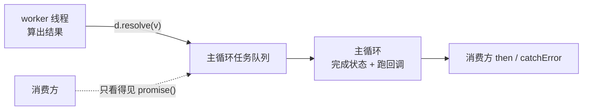

# 04 · Promise、Deferred 与事件

## 4.1 为什么不用 Future

JDK 自带的 `CompletableFuture` 完全能表达异步。但它的一个默认行为和这套框架冲突：回调跑在**完成它的那个线程**上。

回忆第三章：框架的所有状态都只允许在主循环上改。如果 worker 完成任务后直接跑回调，回调就会在 worker 上改状态——无锁前提当场破裂，而且这种 bug 不会报错，只会偶发。

于是需要一个小型的、**语义绑定在主循环上**的 Promise：无论谁、在哪个线程完成它，回调和后续操作一律回到主循环执行。

## 4.2 两半：Deferred 与 Promise

```java
Deferred<String> d = scheduler.defer();   // 生产方持有：谁算结果谁拿它
Promise<String> p = d.promise();          // 消费方只读：只能 then/catch
d.resolve("ok");                          // 任意线程可调
```

拆成两个类型的意义不是 API 洁癖，而是**方向明确**：



- `Deferred` 是**写句柄**，只交给生产方。它有三个方法：`promise()`、`resolve()`、`reject()`。
- `Promise` 是**读视图**，没有完成接口。消费方不可能"顺手把结果改掉"。
- 完成是幂等的，首个生效。迟到的第二次 `resolve` 被静默忽略——这一点很重要：取消之后任务才跑完，结果不该覆盖已取消的状态。

## 4.3 回调一定在主循环上

`then` 的映射函数跑在主循环：

```java
Promise<Disposable> p = offload(...)      // 在 worker 上建连
        .then(conn -> new SqliteService(ctx, conn));  // 在主循环上构造服务
```

这个组合正好把第三章的两条铁律串起来了：**阻塞活给 worker，状态变更回主循环**。两段式初始化（第五章）就是这条链的产物。

反过来说，`.then` 里绝不能写阻塞调用。写了会立刻撞上 `readSync` 的 `assertNotMainLoop`——这是好事，错误在发生点暴露，而不是变成"偶尔卡住"。

| 方法 | 语义 | 常见用途 |
|---|---|---|
| `then` | 同步映射，返回值进入下一环 | 构造服务、变换结果 |
| `thenAsync` | 映射返回新的 Promise，等它 | 串接第二段阻塞工作 |
| `catchError` | 只在失败时调用，恢复成正常值 | 降级、重试 |
| `handle` | 成功失败都调用，继续传递原结果 | 记日志、收尾 |
| `all` | 全成功才算成功 | 等一批插件装载完 |
| `allSettled` | 都等完，逐个报告成败 | 批量卸载、批量探活 |
| `join` | **阻塞**等待 | 只给 main 与测试 |

## 4.4 `join()` 是唯一允许的阻塞点，也是唯一的自杀方式

```java
public T join() {
    if (scheduler.inMainLoop()) {
        throw new IllegalStateException("Promise.join() must not be called on the main loop");
    }
    ...
}
```

在主循环上 `join` 不是"慢"，是**永久死锁**：结算动作本身排在主循环队列里，而主循环正在等你。整个框架的所有插件、所有事件全部冻结，没有任何日志。

实测过这种误用的表现：服务看起来启动了，但什么都不响应，CPU 占用为 0。所以这里做了 fail-fast。

框架内部从不调用 `join`。它只出现在两个地方：`main` 方法里的最终同步点，以及 demo 的断言。

## 4.5 事件：五种派发语义

事件系统和 Promise 是一体两面的：Promise 处理"一个结果"，事件处理"多个观察者"。

```java
ctx.on("agent/tool", args -> { ... });     // 返回 Disposable，随 fiber 自动解绑
ctx.events.emit("agent/reply", content);
```

监听器注册在**上下文**上而不是全局表上，所以它天然是 fiber 的 effect：插件卸载，监听器自动解绑，不会留下"野监听器"。

五种派发方式，选错了会产生很难查的问题：

| 模式 | 语义 | 用在哪 |
|---|---|---|
| `emit` | 同步广播，不等返回值 | 日志、通知、埋点 |
| `serial` | 依次**等待**每个监听器 | 有顺序要求的钩子 |
| `bail` | 首个非 `undefined` 即停 | "谁能处理这个请求" |
| `waterfall` | 管道改写，每个监听器收到上一个的输出 | **组装 prompt**、改写请求 |
| `parallel` | 并发，收集所有异常 | 清理、批量探活 |

`waterfall` 在这个项目里最值得注意：`system/prompt` 这类事件非常适合用它做"中间件链"——基础提示词往下传，技能插件追加清单，安全插件追加约束，谁都不用知道别人存在。当前实现里 system 是直接用 `SystemProvider` 函数拼的（更简单），但同一个需求用 waterfall 也能表达，且更适合多方扩展。

监听器返回 `Promise` 时，派发自动进入异步链路——不用为"异步监听器"另造一套 API。

## 4.6 事件不是万能的：会话级 vs 全局

`AgentService` 有两条通知通道，这个设计值得单独记：

```java
ctx.events.emit(EVT_TOOL, name, result);      // 全局：没有会话标识
listener.onToolResult(name, result);          // 会话级：只给本次 run 的调用方
```

全局事件适合日志与监控。但多会话并发时，监听器收到的 `EVT_TOOL` 不带 session id，**分不出是哪个会话的**。所以给 UI 推 SSE 必须用会话级监听器：每次 `run` 一个 `AgentListener` 实例，天然按次隔离，不需要给事件加 ID，也不需要全局串行。

一句话概括：**广播给全世界用的走 events，只给一个人看的走 listener。**

## 4.7 effect：把"注册"变成可撤销的操作

第四章最后要确立一个习惯：凡是"注册"，都返回 `Disposable`。

```java
ctx.on(...)              // → Disposable
tools.add(tool)          // → Disposable
fiber.effect(...)        // → Disposable
```

有了这个约定，生命周期就只剩下一条规则：**fiber 卸载时，把收集到的 Disposable 逆序执行**。不需要在每个插件里手写 `try/finally`，也不需要维护"我注册过什么"的账本——账本由 fiber 持有。

这也是为什么 `ToolComponent.apply` 只有三行：它把"注册工具"这个动作的 Disposable 直接交出去，剩下的全归框架管。

## 4.8 代价

- **多了两层间接**。写一个简单流程要在 `offload` / `then` / `thenAsync` 之间选择，判断成本真实存在。
- **异常容易被吞**。`catchError` 恢复后，原始错误就没下文了。约定是：恢复的同时必须 `emit` 一个事件或打日志，否则线上排障会两眼一抹黑。
- **`join` 的诱惑**。它太好用了，一旦出现在业务代码里，异步模型就退化成了同步模型，只是多绕了几个线程。代码 review 时应该专门盯这个。

---

**下一章**：[05 · 能力层的形状](05-capability-layer.md) —— 为什么文件系统不该知道什么是 tool result。
