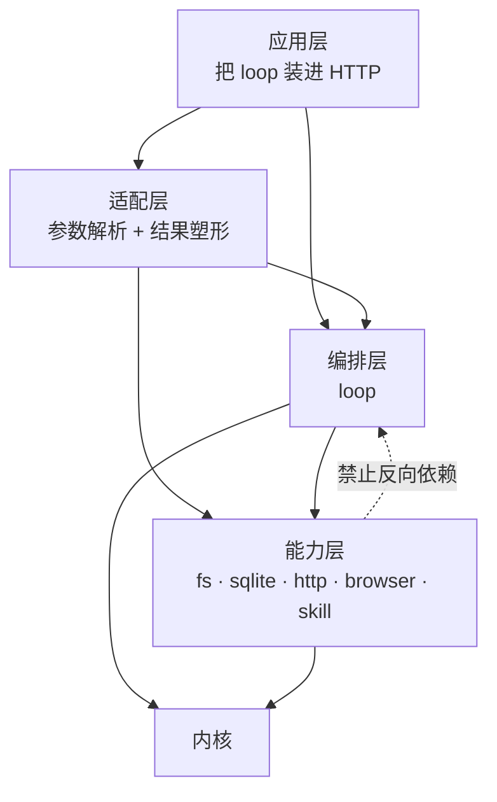
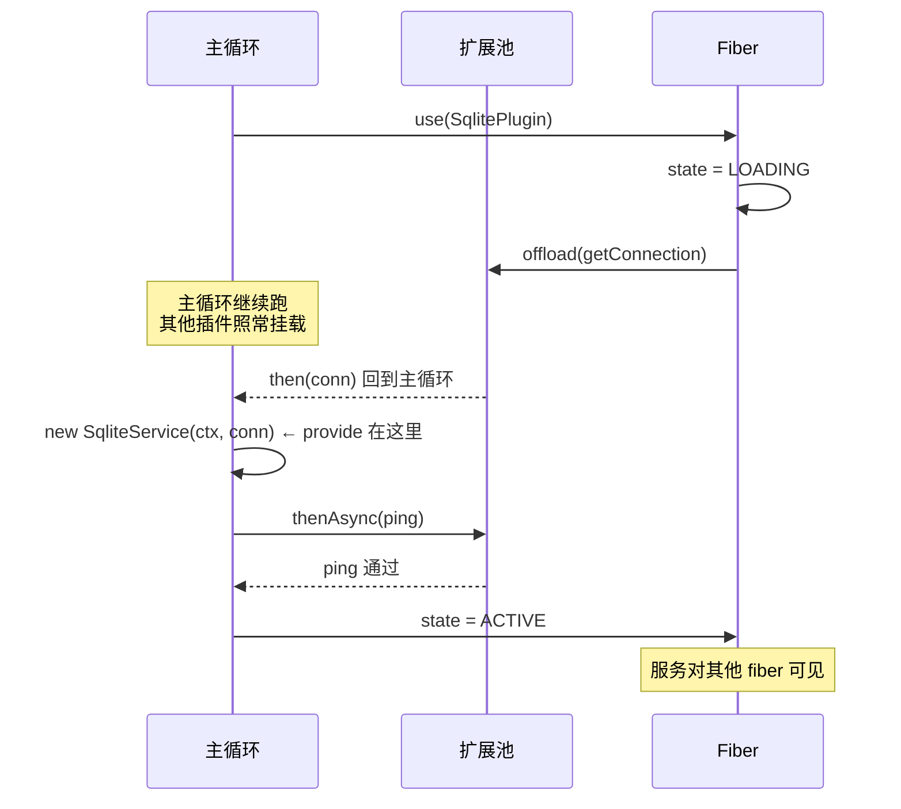

# 05 · 能力层的形状

## 5.1 一条分层红线

判断一个模块属于哪一层，只需要问它返回什么：

```java
FileSlice slice = fs.readSync("README.md", 1, 40);   // 能力层：领域对象
String json = readFileTool.run(args);                // 适配层：给模型看的 JSON
```

能力层返回 `FileEntry` / `FileSlice` / `SkillSlice` / `PageSnapshot` 这样的领域对象，**不返回 JSON 字符串**。它不知道"模型"这个东西存在。

这条红线看着抽象，但它解决的问题非常具体：

- **可复用**。同一个 `FileSystemService` 既能被 agent 的 `read_file` 工具用，也能被 HTTP 接口用，也能被命令行用。如果它直接产出 tool result，就只能服务于模型。
- **可测试**。断言 `slice.lines.size() == 40` 比断言一段 JSON 字符串稳定得多。
- **可演进**。给模型看的 schema 会反复调整（模型换了、措辞改了），但"读文件"这个能力不该跟着改。



最下面那条虚线就是红线：**能力层不认识 agent**。`cordis.fs` 的 import 里不会出现 `cordis.agent`。

## 5.2 两段式异步初始化

能力层最典型的实现难题：**初始化是阻塞的，但服务登记必须在主循环**。

以 SQLite 为例，`DriverManager.getConnection` 是阻塞的；`SqliteService` 的构造器里 `super(ctx, "sqlite")` 会 `provide`，必须在主循环。两个要求不能在同一线程满足。

解法是把初始化切成两段，中间用 Promise 缝合：



代码就是一条链：

```java
public Promise<Disposable> applyAsync(Context ctx, Map<String, Object> config) {
    return ctx.scheduler.<Connection>offload(() -> DriverManager.getConnection(url))
            .then(conn -> new SqliteService(ctx, url, conn))          // 回主循环构造
            .thenAsync(s -> ctx.scheduler.offload(() -> { s.ping(); return s; }))
            .then(s -> (Disposable) () -> ctx.scheduler.offload(() -> { s.close(); return null; }));
}
```

注意最后一段：**关闭也是阻塞的，而卸载跑在主循环上**，所以 close 也要 offload。这是同一枚硬币的两面——凡是阻塞的，两头都得 offload。

`FileSystemPlugin` 用同样的形状，只是第一段阻塞的是 `toRealPath()`（校验沙箱根目录并解析符号链接）。

## 5.3 谁能"立刻返回"：两种异步

同样是网络能力，`HttpService` 没有 offload：

```java
http.get(url).then(res -> res.body);          // OkHttp enqueue，原生异步
```

| 路径 | 机制 | 占用 |
|---|---|---|
| JDBC / 文件 / 浏览器 | `offload` 到扩展池 | 一个 worker 线程 |
| HTTP（OkHttp `enqueue`） | 原生异步回调 | 不占扩展池 |

这不是不一致，而是**按底层能力选择**：JDBC 只有阻塞 API，必须借线程；OkHttp 本来就有异步接口，多借一个线程是纯浪费。代价是两条路径的心智模型不同——`offload` 用完了会还线程，`enqueue` 的回调在 OkHttp 自己的 dispatcher 线程上，所以 `HttpCaller` 里同样只做"投递回主循环"这一件事。

判断标准很简单：**底层有没有非阻塞接口？** 有就用，没有就 offload。

## 5.4 阻塞能力要显式声明

能力层的同步方法统一带 `Sync` 后缀，并在入口断言：

```java
public FileSlice readSync(String path, int offset, int lines) {
    assertNotMainLoop("FileSystemService.readSync");
    ...
}
```

`*Sync` + 断言，等于给每个方法贴了一张标签："我会阻塞，别在主循环上叫我"。命名承担文档职责，断言承担执行职责。

对应的异步包装也很薄：

```java
public Promise<List<FileEntry>> list(String path) {
    return ctx.scheduler.offload(() -> listSync(path));
}
```

## 5.5 能力层还要负责"边界"

一个反直觉的点：沙箱校验不属于安全模块，属于文件系统**自己**。

```java
Path candidate = root.resolve(raw.trim()).normalize();
if (!candidate.startsWith(root)) { throw ... }        // 词法校验
if (!anchor.toRealPath().startsWith(root)) { throw } // 真实路径校验
```

理由：任何调用方都可能传进一个 `../../etc/passwd`。如果沙箱校验放在上层，那么"绕过校验"只需要换一个调用方。放在能力层内部，就没有"另一个入口"。

同理，HTTP 的重定向逐跳校验放在 `HttpCaller`，而不是放在"给模型用的 http 工具"里。**边界必须和实现贴在一起**，否则它迟早被复制粘贴掉。（第十一章展开具体策略。）

## 5.6 能力清单

| 能力 | 服务名 | 关键方法 | 特点 |
|---|---|---|---|
| 文件 | `filesystem` | `readSync` / `writeSync` / `grepSync` | 沙箱、审批、上限、原子写 |
| SQLite | `sqlite` | `execute` / `query` / `transaction` | 两段式初始化、共享连接、写锁 |
| HTTP | `http` | `get` / `postJson` / `stream` | 原生异步、逐跳白名单 |
| 浏览器 | `browser` | `openSync` / `snapshotSync` / `clickSync` | Playwright、按 `ref` 操作 |
| 技能 | `skills` | `list` / `systemSection` / `bodySync` | 清单常驻、正文窗口 |

五者的共同点：**都只返回领域对象，都不知道模型的意图**。区别只在阻塞特性与安全策略。

## 5.7 代价

- **多一层转换**。每次工具调用都要"领域对象 → JSON"，这段代码是纯开销。
- **能力层必须自己想清楚安全**。不能把边界推给上层，意味着每个能力都要独立实现一套校验，重复劳动。
- **`Sync` 后缀满天飞**。一眼看过去全是 `*Sync` 方法，初读会觉得"为什么不用异步"。答案在第三章：同步方法是给已经在线程池上的人用的，避免二次 offload。

---

**下一章**：[06 · 工具的契约](06-tool-contract.md) —— 模型和代码之间唯一需要严格约定的地方。
