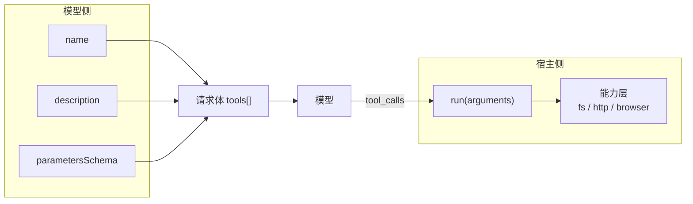
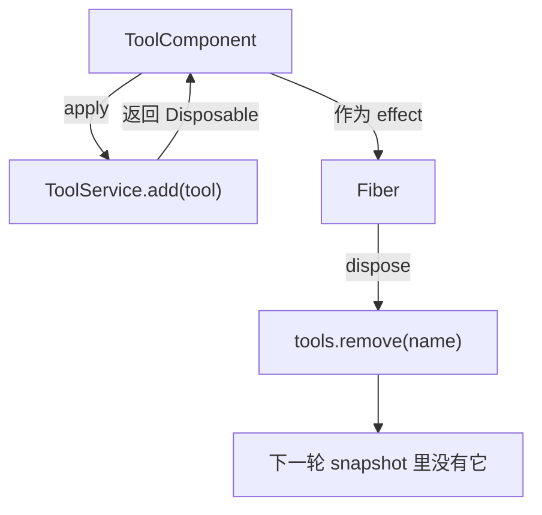

# 06 · 工具的契约

## 6.1 一个接口，两种读者

`Tool` 有四个方法，但它们并不服务于同一个读者：

```java
public interface Tool {
    String name();                 // 给模型看 + 注册键
    String description();          // 给模型看
    String parametersSchema();     // 给模型看
    String run(String arguments);  // 给框架调
}
```

前三个方法会被序列化成 JSON 塞进请求体，模型据此决定"要不要用、怎么用"。第四个方法模型看不到，它只在宿主进程里执行。

这个不对称是全部设计的基础：**前三个方法写得再好，也只能提高"模型用对"的概率；`run` 写得再稳，也只能保证"用错时不炸"。** 两者缺一不可，且互相不能替代。



## 6.2 描述是接口文档，不是注释

一个 agent 里，工具描述的质量直接决定成功率。三条经验规则，都来自实际踩坑：

**规则一：描述要写"什么时候用"，不只写"是什么"。**

```java
// 弱：模型不知道何时该选它
"读取文件"

// 强：给了触发条件和使用方式
"读取文本文件的一段。offset 是 1 基行号，lines 是最多读的行数（默认 30）。"
```

**规则二：参数的 schema 要能挡住愚蠢调用。**

```json
{"type":"object","properties":{
  "path":{"type":"string","description":"文件路径，相对工作区根"},
  "offset":{"type":"integer","description":"起始行号（1 基），默认 1"},
  "lines":{"type":"integer","description":"最多读多少行，默认 30"}
},"required":["path"]}
```

`required` 写清楚、默认值写进描述、单位写明白（1 基还是 0 基、字节还是行）。模型不会猜，它只会按字面理解。

**规则三：不要让一个工具做两件不相关的事。** 名字是模型选择工具的唯一键，`do_stuff` 这种名字等于没给。

## 6.3 `run` 的线程契约

```java
String run(String arguments) throws Exception;
```

三条约定：

1. **在 worker / toolPool 线程上同步调用**，允许阻塞。查库、算密、发请求都可以直接写。
2. **`arguments` 是模型产出的原始文本**，解析责任在工具自己。别指望它一定合法。
3. **返回值原样回填给模型**，约定为 JSON 文本。

第 3 条是"能用"的关键。模型下一步的决策完全依赖这段文本，所以它要**信息密度高、结构稳定、体积可控**。返回一坨 HTML 原文，模型读不懂；返回 `{"ok":true}`，模型什么也干不了。好的形状是：

```json
{"path":"README.md","startLine":1,"totalLines":654,"lines":["# cordis-java","","..."]}
```

## 6.4 失败是数据，不是异常

这是 agent 工程里最容易搞反的一条。

传统服务里，工具失败 → 抛异常 → 整个请求 500。agent 里，工具失败 → **回填错误文本** → 模型看到、改道、重试。

```java
try {
    return tool.run(request.arguments);
} catch (Exception e) {
    return ToolError.of("tool " + request.name + " failed: " + e);
}
```

`ToolError.of` 只做一件事：把错误消息安全地转义成 `{"error":"..."}`。

为什么不能手拼字符串？因为异常消息里可能有一个引号、一个换行。拼进 JSON 就是非法 JSON，而**一段非法的历史会让后续所有请求被网关拒掉**——本轮的错，变成会话的绝症。

为什么不是所有失败都回填？看 `AgentService` 的策略表：

| 失败 | 处理 | 理由 |
|---|---|---|
| 模型调用失败 | 整个 run rejected | 网络断了重试一轮没意义，交给调用方 |
| 工具执行抛异常 | 回填 `{"error":...}` | 工具坏了是常态，模型能换路 |
| 工具名不存在 | 回填 `unknown tool: xxx` | 可能在"模型请求"与"执行"之间被热卸载了 |
| 参数 JSON 非法 | 由工具自己决定是否抛 | 抛了就变成上一条 |

一句话：**模型能处理的错误，交给模型；模型处理不了的，交给人。**

## 6.5 一个工具 = 一根 fiber

工具的热插拔不需要任何新机制，只要三步闭合：

```java
// 1. 工具注册返回 Disposable
Disposable reg = tools.add(new MyTool());

// 2. 组件把 Disposable 交出去
public Disposable apply(Context ctx, Map<String, Object> config) {
    return ctx.get("agent.tools").add(tool);
}

// 3. fiber 卸载时逆序回收，工具自动消失
fiber.dispose();
```



于是"把这个工具下线"就是 `fiber.dispose()`，"重新上线"就是再 `use()` 一次。agent 不需要知道发生过什么——它每轮都重新取快照。

配套的两条实现细节：

- **同名工具注册直接抛异常**，不静默覆盖。名字是模型请求的唯一键，两个 fiber 各自以为自己的工具在线上，是最难查的一类问题。
- **快照按名字排序**。顺序稳定意味着发给模型的 `tools[]` 逐字节一致，便于缓存与 diff。

## 6.6 工具的三种形态

看仓库里的实际工具，会发现三个层次：

| 形态 | 例子 | 特点 |
|---|---|---|
| 薄封装 | `read_file`、`list_dir` | 解析参数 → 调 `*Sync` → 塑形 JSON |
| 带策略 | `http_get`、`browser_*` | 调用前过白名单、逐跳校验 |
| 带自纠错 | `use_skill` | 名字拼错时返回可用列表，让模型自己改 |

第三种值得单独说。`use_skill("markdown-writter")` 会失败，但错误文本里带上 `available: markdown-writer, pdf, ...`，模型下一轮就能自己改对。**把纠错信息设计进错误消息**，能显著减少无效轮次——这也是为什么错误必须是结构化的文本而不是堆栈。

## 6.7 代码：一个完整的工具

```java
final class ReadFileTool implements Tool {
    private final FileSystemService fs;

    public String name() { return "read_file"; }

    public String description() {
        return "读取文本文件的一段。offset 是 1 基行号，lines 是最多读的行数（默认 30）。";
    }

    public String parametersSchema() {
        return "{\"type\":\"object\",\"properties\":{"
             + "\"path\":{\"type\":\"string\"},"
             + "\"offset\":{\"type\":\"integer\"},\"lines\":{\"type\":\"integer\"}},"
             + "\"required\":[\"path\"]}";
    }

    public String run(String arguments) throws Exception {
        JsonNode args = MAPPER.readTree(arguments);
        FileSlice slice = fs.readSync(args.path("path").asText(""), 1, 30);
        return shape(slice);          // 领域对象 → 给模型的 JSON
    }
}
```

三十行不到，但四个方法各自承担了一个明确的责任。写新工具时照着这个骨架填就行——**难点从来不在代码量，而在名字和描述的措辞**。

## 6.8 代价

- **描述要反复调**。同一个工具，换个模型可能就要改措辞。这是持续的维护成本。
- **错误回填掩盖了真实故障**。工具一直失败，模型会一直换路，服务看起来"能用"但什么也没做成。所以失败的次数必须被观测（第十二章）。
- **工具越多越难选**。给模型 20 个工具，它选错的概率明显上升。宁可分开装配：不同场景给不同工具集。

---

**下一章**：[07 · agent loop](07-agent-loop.md) —— 全书核心，一个 for 循环和它的四条纪律。
