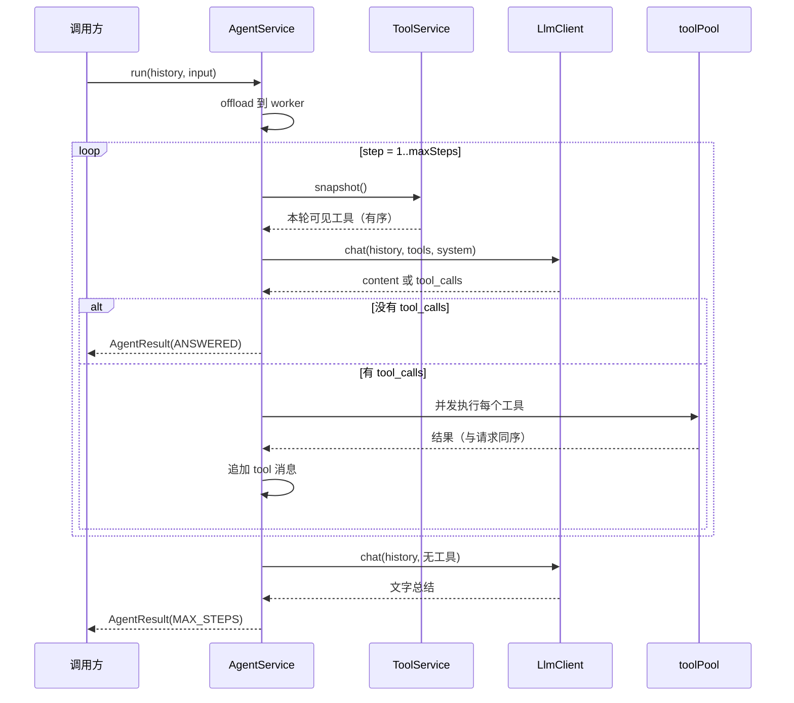
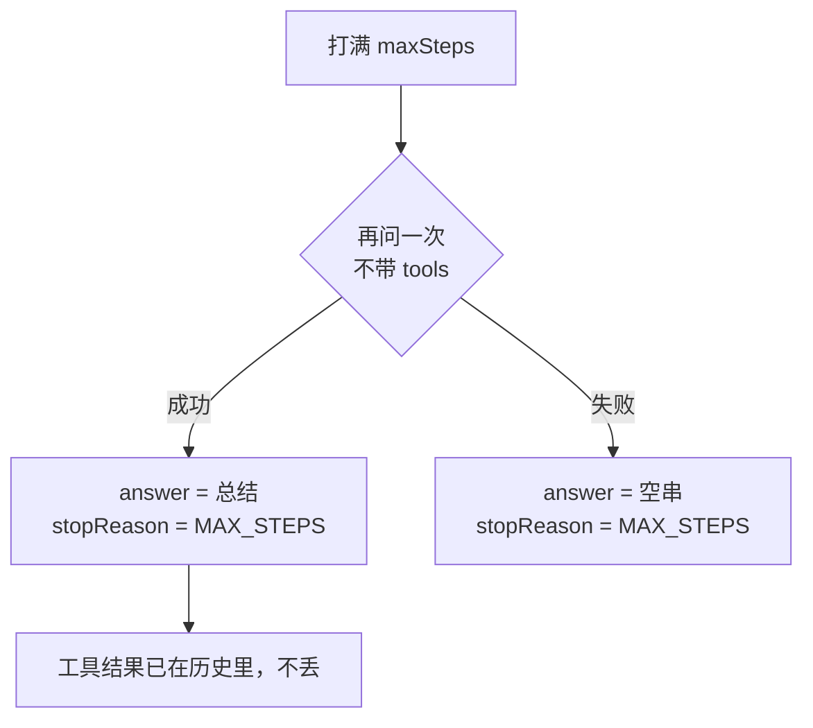
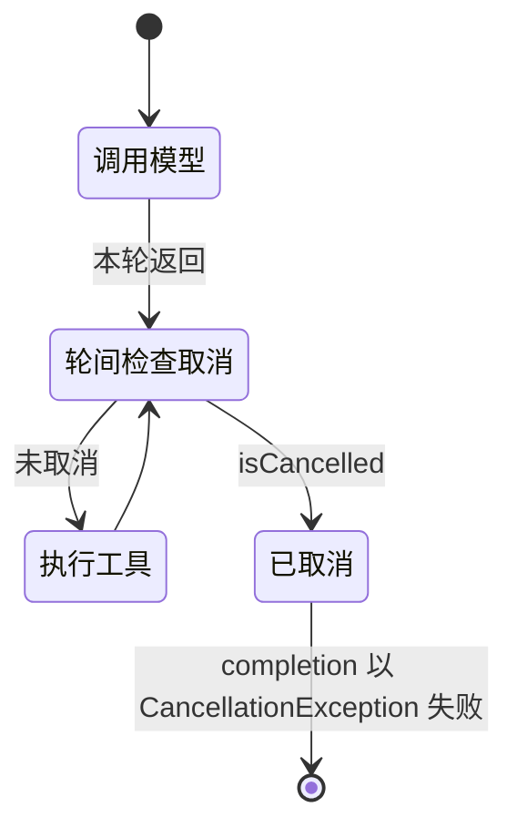

# 07 · Agent Loop

## 7.1 一个 for 循环，四条纪律

上一章之前的铺垫到这里全部汇合：内核提供生命周期，线程模型提供并发，工具提供"真的能做"。循环本身反而最短。

```java
history.add(LlmMessage.user(input));

for (int step = 1; step <= maxSteps; step++) {
    if (call.isCancelled()) throw new CancellationException();

    List<Tool> available = tools.snapshot();        // 纪律一：每轮重新取快照
    String system = systemProvider.provide();       // 纪律二：system 每轮求值

    LlmReply reply = llm.chat(history, available, system);
    history.add(LlmMessage.assistant(reply));

    if (!reply.hasToolCalls()) {
        return answered(reply.content, step);
    }

    List<String> results = dispatchAll(available, reply.toolCalls);  // 纪律三：并发执行
    for (int i = 0; i < reply.toolCalls.size(); i++) {              // 纪律四：按请求顺序回填
        history.add(LlmMessage.toolResult(reply.toolCalls.get(i).id, results.get(i)));
    }
}
return forcedSummary(history);      // 打满轮数
```

四条纪律每一条都对应一类真实故障，下面逐个讲。

## 7.2 时序



整个序列跑在**扩展池的一个 worker** 上。模型调用、工具执行都在那里同步进行，主循环从头到尾不参与——只在 `emit` 事件时被投递消息。

## 7.3 纪律一：工具快照在轮初取一次

```java
List<Tool> available = tools.snapshot();
```

为什么不是每次 `dispatch` 都去 `tools` 里查？

因为**同一轮的工具调用必须面对同一个现实**。如果快照在轮中变化，"模型看到 5 个工具、实际执行时只剩 3 个"就会发生，而模型对此一无所知，只会觉得"这个工具怎么坏了"。

在这个快照语义下，"模型请求了但执行时已卸载"的情况仍然可能发生（快照之后被 dispose），此时回填：

```
{"error":"unknown tool: math"}
```

模型能看到，下一轮重新取快照就不会再请求它。**同一轮内一致，跨轮允许变化**——这就是热插拔的正确语义。

## 7.4 纪律二：system 每轮重新求值

```java
public interface SystemProvider {
    String provide();      // 每轮调用一次
}
```

如果 system 在装配时固化成字符串，技能清单就永远停在启动那一刻。而技能目录是可以重扫的（重装 `SkillPlugin` → fiber reload → 内存快照更新），下一轮就该看到新清单。

所以 system 是**配置**，不是**记忆**：

- 不进 `history`，不会被持久化层当成对话存下来；
- 每轮重新计算，动态段（技能清单、可用工具补充说明）永远是最新的。

`AgentServer` 的实现很直白：

```java
final SystemProvider system = () -> {
    SkillService skills = ctx.get("skills");
    String section = skills == null ? "" : skills.systemSection();
    return section.isEmpty() ? BASE_SYSTEM : BASE_SYSTEM + "\n\n" + section;
};
```

注意 `ctx.get("skills")` 可能返回 null——技能插件没装或正在 reload。这里的处理是降级成空段，而不是抛异常。**system 求值失败会让整个 run rejected**，为一个可选段付出这个代价不值得。

## 7.5 纪律三：同一轮的工具并发执行

模型一次请求多个工具是很常见的（"同时看看这两个文件"）。串行执行会把 N 个往返串成 N 倍延迟。

```java
List<Future<String>> futures = new ArrayList<>();
for (ToolCall request : requests) {
    futures.add(toolPool.submit(() -> dispatch(available, request)));
}
```

用 `AgentService` **自带的** `toolPool`，不是 `scheduler.offload`——理由在第三章：loop 自己已经占了一个 worker，从 worker 再往同一个池提交并阻塞等待，池子满时会自锁。

并发带来的新问题：工具之间可能互相干扰（同时写同一个文件、同时用一个非线程安全的连接）。这一点框架不管，**由工具实现自己负责**：`Tool.run` 的契约里写的是"单次 run 内部的并发由工具自己处理"。

## 7.6 纪律四：结果按请求顺序回填

```java
for (int i = 0; i < reply.toolCalls.size(); i++) {
    history.add(LlmMessage.toolResult(reply.toolCalls.get(i).id, results.get(i)));
}
```

工具是并发执行的，谁先完成不一定。但历史里的顺序**必须**和 `assistant.tool_calls` 的顺序一致。

原因是协议约束：下一轮请求里，`assistant` 消息带着一组 `tool_calls`，紧随其后的 `tool` 消息通过 `tool_call_id` 与它们配对。顺序错乱时，有的网关会直接 400，有的会静默错配——后者更可怕，模型会读到张冠李戴的结果，然后基于错误信息继续推理。

同理，`id` 必须在。`OpenAiLlmClient` 在构造请求时对这个做了硬校验：

```java
if (call.id == null || call.id.isEmpty()) {
    throw new IllegalStateException("assistant tool call has no id; "
            + "the following tool message could never be paired");
}
```

## 7.7 打满轮数：强制收尾

`maxSteps` 是必需的——没有上限时，一个执着的模型可以永远要工具。但"打满"不等于"失败"，处理方式值得说清楚。

错误做法有两个：

```java
return new AgentResult("(max steps reached: 8)");   // 伪装成答案
throw new IllegalStateException("too many steps");  // 丢掉已有成果
```

第一种让调用方分不清这句话是模型说的还是框架说的；第二种把前面几轮工具辛苦拿到的结果全扔了。

正确做法是**强制收尾**：不带工具清单再问一次。

```java
LlmReply forced = llm.chat(history, Collections.<Tool>emptyList(), system);
```

payload 里没有 `tools` 字段，模型无工具可调，只能基于已经回填的工具结果写一段总结。`stopReason` 仍然是 `MAX_STEPS`（如实报告发生了什么），`answer` 是这段总结。



注意收尾调用**不计入 steps**。工具循环确实只跑了 `maxSteps` 轮，这个数字要诚实。

还有个细节：不给工具时，个别模型仍会回 `tool_calls`。必须忽略调用只取文本，否则历史里留下悬空的 `tool_calls`，下次请求就非法了。

## 7.8 取消：粒度是轮，不是毫秒

```java
AgentCall call = agent.run(history, "现在几点了？");
call.dispose();     // 不等了
```

`dispose` 之后，loop 在**轮间**检查标志，不再开始下一轮。正在阻塞的模型调用不会被中断——HTTP 读循环没有检查取消的位置。



这是刻意的取舍：真正的毫秒级取消需要流式读循环配合（在 `readUtf8Line` 里判标志），复杂度大幅上升，收益有限。当前语义足够"用户点停止"这个场景——最多多等一次模型往返。

一个容易忽略的点：**取消后已产生的消息仍然落库**。保留已发生的事实，比丢弃半段对话更可控；`ConversationService` 明确写明了这个行为。

## 7.9 两条通知通道

```java
ctx.events.emit(EVT_STEP, step, available.size());  // 全局：日志、监控
listener.onStep(step, available.size());            // 会话级：本次 run 的调用方
```

第三章、第四章都提过，这里给出完整对照：

| | 全局事件 | 会话监听器 |
|---|---|---|
| 归属 | `ctx.events`，全进程 | 每次 `run` 一个实例 |
| 标识 | 不带 session id | 天然属于本次调用 |
| 并发 | 多会话事件混在一起 | 各推各的 SSE，真并发 |
| 适合 | 日志、指标、审计 | UI 实时输出、流式响应 |
| 监听器抛异常 | 被 `emit` 吞掉并记录 | 被 `guard` 吞掉并记录 |

两者都在同一位置发出，顺序一致。区别只是"发给全世界"还是"只发给你"。

## 7.10 请求体积观测

长会话最容易出的问题不是答错，是**越跑越慢越贵**。所以 loop 里埋了一个可选的观测点：

```java
if (stats) {
    listener.onStats(step, measure(history, systemPrompt));
}
```

`HistoryStats` 按 role 分桶累加字符数（system / user / assistant / tool），给出一条"每轮请求有多大"的曲线。`AgentServer --debug` 会把它推成 SSE 的 `stats` 帧，`final` 帧里还带 `requestCharsByStep`。

这不是调试工具，是**运营工具**：看到曲线在第 6 轮突然跳 10 万字符，就知道那个工具返回的东西太肥了。（第十章展开。）

## 7.11 代价

- **一轮至少两次网络往返**（模型 + 工具 + 模型），latency 上限被钉住。
- **历史只增不减**，成本随轮次线性上涨。省钱需要主动设计（第九章的 qa 主干、第十章的各种截断）。
- **工具并发引入了新的不确定性**。同一个文件被两个工具同时写，结果取决于调度顺序。
- **强制收尾的质量取决于模型**。有些模型在"无工具可调"时会给出一段含糊的总结，比报错更让人困惑。

---

**下一章**：[08 · 模型适配层](08-llm-wire.md) —— 为什么流式解析不该渗进循环。
