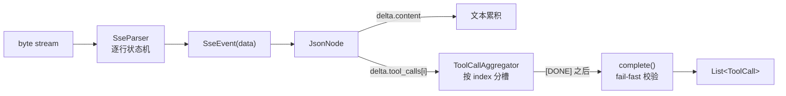

# 08 · 模型适配层

## 8.1 接口只有一句话

```java
LlmReply chat(List<LlmMessage> history, List<Tool> tools, String systemPrompt);
```

把它展开成一个契约：

- **我收到**：截至当前的全部消息、本轮可见的工具、本轮的 system 指令；
- **我返回**：模型这一次的决定——一段文本，或者一组工具调用，或者两者都有；
- **我不负责**：历史怎么攒、工具怎么执行、失败怎么重试、流式怎么展示。

这条边界让上面所有东西都可以替换：换成 OpenAI、Azure、vLLM、Ollama、DeepSeek，只需要换 `baseUrl` / `apiKey` / `model` 三个字符串，`AgentService` 一行不改。

`LlmClient` 是接口，`OpenAiLlmClient` 是唯一实现，位于 `cordis.agent.llm`。**wire 协议不出现在框架的其他地方**——`cordis.core` 与 `cordis.agent` 都不依赖 JSON 库，这个约束值得在项目里当成硬规矩。

## 8.2 请求体的形状

```json
{
  "model": "gpt-4o",
  "messages": [
    {"role": "system",    "content": "你是一个谨慎的助手..."},
    {"role": "user",      "content": "看一下工作区有哪些文件"},
    {"role": "assistant", "content": null,
     "tool_calls": [{"id":"call_1","type":"function",
                     "function":{"name":"list_dir","arguments":"{\"path\":\".\"}"}}]},
    {"role": "tool", "tool_call_id": "call_1", "content": "{\"entries\":[...]}"}
  ],
  "tools": [
    {"type":"function","function":{"name":"list_dir","description":"...","parameters":{...}}}
  ],
  "stream": true
}
```

三个细节容易踩：

1. **`system` 不在 `history` 里**。它是配置不是记忆，混进去会被持久化层当对话存下来。
2. **带 `tool_calls` 的 assistant 消息，`content` 按规范可以是 `null`**。规范允许空串，但 `null` 更贴近各家模型训练时的形态。
3. **`tool` 消息必须带 `tool_call_id`**。这是配对键，缺了就是非法历史。

## 8.3 流式：为什么要聚合

模型流式输出时，工具调用是**碎片**：

```
data: {"choices":[{"delta":{"tool_calls":[{"index":0,"id":"call_1","function":{"name":"read_file","arguments":""}}]}}]}
data: {"choices":[{"delta":{"tool_calls":[{"index":0,"function":{"arguments":"{\"path\":"}}]}}]}
data: {"choices":[{"delta":{"tool_calls":[{"index":0,"function":{"arguments":"\"README.md\"}"}}]}}]}
data: {"choices":[{"delta":{},"finish_reason":"tool_calls"}]}
data: [DONE]
```

注意第二片：`{"path":` 是**半截 JSON**，此刻不可能被解析。所以聚合器只能做纯拼接，等到流结束再校验一次。



聚合器是一个很小的状态机，三条规则：

| 规则 | 原因 |
|---|---|
| 按 `index` 分槽，不按到达顺序 | 并发工具调用时，不同槽位的分片会交错到达 |
| `id` / `name` 只在首片出现，后续为 null | 重复出现时以首个为准 |
| `arguments` 纯追加 | 中途不可解析，只拼接 |

`complete()` 会 fail-fast：某个槽位从没收到 `name`（流被截断）直接抛异常。

```java
if (slot.name == null) {
    throw new IllegalStateException("tool call #" + index + " is incomplete");
}
```

为什么不返回一个 `name=null` 的残次调用？因为它会在 dispatch 时变成 `unknown tool: null`，错误离根因隔了整整一轮——模型会以为工具名写错了，然后换个名字再试一次。

## 8.4 校验放在"交付前"这一格

`OpenAiLlmClient` 有两道校验，位置都很有讲究：

```java
private void requireParsable(ToolCall call) { ... }   // 参数是不是完整 JSON
private static void requireFinishReason(String fr) {  // 输出是不是被截断
    if ("length".equals(fr)) throw new IOException("output truncated");
}
```

第一道解决"聚合器看不出参数只到一半"的问题——拼接完的字符串可能是 `{"path":`，只有解析一遍才知道。

第二道解决一个非常隐蔽的现象：**输出被 `max_tokens` 截断时，网关仍然返回 200，只是 `finish_reason` 变成 `length`**。忽略它，你就会把半截答案当终答交给用户。实测里有些模型在这种情况下 `content` 是空的——用户看到的是"agent 什么都没说"，而不是"输出超长"。

原则：**所有校验在交付前做完，让错误发生在适配层**。loop 收到的 `LlmReply` 一定是自洽的。

## 8.5 为什么用同步 `execute` 而不是 `HttpService.stream()`

直觉上，流式就该用流式 API。但这里刻意用了阻塞读：

```java
Response response = call.execute();
return stream ? readStream(body) : readWhole(body);
```

理由是契约：`LlmClient.chat` 的语义本来就是"在 worker 上阻塞到本轮出结果"。用 `execute`，一条流只占一个 worker，读完就还。

`HttpService.stream()` 面向的是另一类场景——事件要**边到边推**给上层（UI、日志），不能等。如果 loop 用它，就得把"等流结束"变成事件回调，loop 立刻从同步循环变成状态机，复杂度爆炸。

代价是：**没有毫秒级取消**。读循环里没有检查 `isCancelled()` 的位置，所以 `AgentCall.dispose()` 只能等这一轮读完。（要支持的话，在 `readUtf8Line` 循环里判标志即可，是个局部改动。）

顺带一个必须知道的配置：

```java
readTimeout(stream ? 0 : 300, TimeUnit.SECONDS)
```

流式必须 `readTimeout(0)`。模型思考期间连接上可能长时间一个字节都没有，任何非零读超时都会被误判成"连接断了"。代价是失去卡死保护——由取消与进程退出兜底。

## 8.6 网关怪癖清单

这些都是实测得来的，写在这里省得下一个人重新踩：

| 现象 | 应对 |
|---|---|
| 只接受 `system/user/assistant/tool` 四种角色，发 `developer` 直接 400 | 别用新角色名 |
| 响应里的 `model` 被换成上游真名 | 任何分支判断都不能看它 |
| 非流式响应同时带 `delta: null` 和 `message` | 按 `message` 读，忽略 `delta` |
| 流式块额外带 `lastOne`，DeepSeek 带 `reasoning_content` | 侧载字段，一律忽略 |
| 200 的流里塞 `{"error":...}` | 显式检查 `error` 字段并抛错 |
| `[DONE]` 之后才关闭连接，个别网关不发 `[DONE]` 就断 | 读循环结束后 `parser.flush()` 吃掉最后一条 |

最后一条尤其容易被忽略：没有以空行收尾的最后一帧，如果不 flush 就整条丢掉。表现是"偶尔少一次工具调用"。

## 8.7 两个实现，一个接口

仓库里有两种 `LlmClient`：

- `OpenAiLlmClient` —— 真实网络。
- demo 里的脚本实现（`AgentDemo.AdaptiveLlm`）—— 按 `history` 的最后一条消息决定"下一步说什么"。

第二种不是玩具。它让 loop 的每一个分支都能在没有网络、没有 API Key、没有费用的情况下被验证：工具调用、热插拔、取消、流式聚合、打满轮数、错误回填。

**先让循环在脚本模型上正确，再接真实模型**——这是第十三章的核心方法论，而它能成立的前提，就是这里这个只有一个方法的接口。

## 8.8 代价

- **一家一个协议**。OpenAI 兼容已经成了事实标准，但 Anthropic 等格式仍要单独适配。适配层会随接入模型数量增长。
- **流式聚合的状态机难测**。分片乱序、截断、缺 `[DONE]`，组合起来是很长一串边界。好在聚合器是纯函数式的（喂进去、拿出来），单测成本低。
- **`readTimeout(0)` 的风险**。连接真的挂死时，这个 run 会一直占着一个 worker。需要有会话级超时兜底。

---

**下一章**：[09 · 记忆与会话](09-memory.md) —— 会话不是聊天记录。
