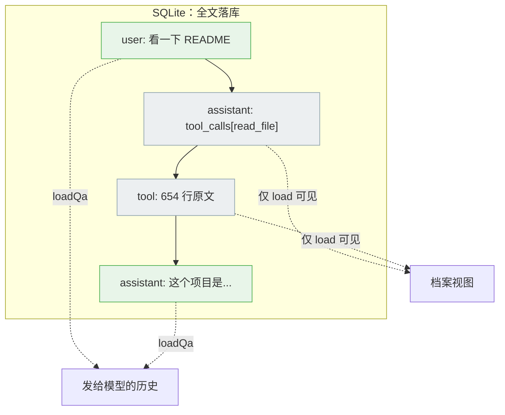

# 09 · 记忆与会话

## 9.1 一个重要的认知转变

初学者常把"记忆"理解成"把聊天记录存起来"。这只对了一半。

在 agent 里，记忆的真正定义是：**下一次请求要重新发送什么**。

这个定义一换，问题的形状就变了：

- 不是"存多少"，而是"发多少"——历史每轮重发，全部内容都在为 token 付费；
- 不是"怎么排序展示"，而是"协议要求什么格式"——顺序错了网关直接 400；
- 不是"用户聊过什么"，而是"模型需要知道什么才能继续"。

`MemoryService` 的两个读法（`load` 与 `loadQa`）就是这个认知的直接产物。

## 9.2 表结构

```sql
sessions(id TEXT PRIMARY KEY, created_at INTEGER, updated_at INTEGER)

messages(id INTEGER PRIMARY KEY AUTOINCREMENT,
         session_id TEXT NOT NULL,
         seq        INTEGER NOT NULL,
         role       TEXT NOT NULL,
         content    TEXT NOT NULL,
         tool_calls TEXT,          -- 转义分隔符格式，不用 JSON 类型
         tool_call_id TEXT,
         qa         INTEGER NOT NULL DEFAULT 0,
         created_at INTEGER NOT NULL,
         UNIQUE(session_id, seq))
```

三个值得解释的字段。

**`seq` 而不是自增主键做主序。** 全局自增 id 在多会话交织时无法表达"这个会话内的第几条"。

**`tool_calls` 存字符串而不是 JSON 类型。** SQLite 没有 JSON 类型，为一个字段引入 JSON 库不划算。用 `ToolCallCodec` 的转义分隔符格式，够用且零依赖。

**`qa` 是本文最重要的一个 bit。** 下面单独讲。

## 9.3 `seq`：在数据库侧原子分配

并发追加时最典型的错误写法：

```java
int next = maxSeq(sessionId) + 1;   // 两个线程都读到 5
insert(sessionId, next, ...);       // 都写 6 → UNIQUE 冲突或覆盖
```

读和写之间的窗口就是竞态。修法有两条路：应用层加锁，或者让数据库一次做完。

这里选了后者，用一条语句：

```sql
INSERT INTO messages (session_id, seq, ...)
SELECT ?, COALESCE(MAX(seq), 0) + 1, ... FROM messages WHERE session_id = ?
```

单条 SQL 在 SQLite 里是原子的，所以 `seq` 天然不重号。应用层的 `writeLock` 依然存在，但它保的是另一件事——见下一节。

## 9.4 轮次必须是事务

`seq` 不重号，不等于"一轮对话是完整的"。

考虑一次工具调用产生的三条消息：

```
assistant(tool_calls=[call_1])     ← 声明了要调用
tool(tool_call_id=call_1)          ← 结果
assistant("答案是 42")             ← 终答
```

如果进程在写完第一条后崩了，库里留下一组"有声明、无结果"的悬空调用。下次 `load` 拿到的历史是**非法的**：

- 有的网关直接 400；
- 更糟的情况是静默接受，然后模型对着一组没有结果的调用继续推理。

所以一轮的所有消息必须**同时可见**：

```java
synchronized (writeLock) {
    db.transaction(() -> {
        for (LlmMessage m : messages) { db.execute(INSERT_MESSAGE, ...); }
        db.execute("UPDATE sessions SET updated_at = ? WHERE id = ?", now, sessionId);
    });
}
```

`writeLock` 不是为 `seq` 准备的，是为**共享单连接**准备的：`SqliteService` 底层只有一条 JDBC 连接，`transaction()` 靠切换 auto-commit 实现，两个事务交错会把后提交的那个打成 `database in auto-commit mode`。所以所有写路径在服务内排队。

## 9.5 `qa`：发问答主干，存全部原文

这是全仓库最有价值的一个设计，值得慢慢讲。

**问题**：一个 agent 跑十轮，每轮工具返回几千字（网页正文、文件全文、grep 结果）。这些内容进了历史，就永远不会出去——每轮请求都要重发一遍。十轮之后，光是工具返回的原文就有几万字，而其中 90% 模型早已用完、再也不需要看。

**做法**：每行都全文落库，但打一个标记：

| `qa` | 内容 |
|---|---|
| `1` | 问答主干：用户问题、不带工具调用的 assistant 终答 |
| `0` | 工具过程：带 `tool_calls` 的 assistant、所有 `tool` 结果 |

于是同一个会话有两种读法：

```java
memory.loadSync(sessionId);     // 全量视图：含工具过程，用于回溯/审计
memory.loadQaSync(sessionId);   // 主干视图：只重发问答主干
```



`AgentServer` 实际用的是 `loadQaSync`：发给模型的历史只含问答主干。

效果：长会话的 token 负担**不随轮次滚雪球**，只随"问答对数"增长。工具返回的原文留在库里，需要回溯时可查。

代价也要说清楚：模型在新一轮里看不到上一轮的工具细节，只知道"我上次读了 README，结论是……"。如果任务需要精确引用上次读到的某一行，这个信息就丢了。取舍点在于——**大多数多轮对话关心的是结论，不是过程**。

## 9.6 读侧修复：残缺配对

即使有事务，库里的数据仍可能不合法——历史遗留数据、外部直接写库、早期没有事务的版本。

所以 `load` 会做一次读侧修复：

```java
private static List<LlmMessage> repairTail(List<LlmMessage> history) {
    for (int i = 0; i < history.size(); i++) {
        LlmMessage m = history.get(i);
        if (!"assistant".equals(m.role) || m.toolCalls.isEmpty()) continue;
        if (answered(history, i, m.toolCalls)) continue;
        return new ArrayList<>(history.subList(0, i));   // 截在第一条不完整的位置
    }
    return history;
}
```

三个关键决策：

1. **只修尾部**。中间的缺口意味着这轮之后还有正常对话，那是脏数据但不归本方法管——按同样规则在中途截断，会丢掉后面所有正常消息。
2. **读侧修，不改库**。库里的数据是事实，读取方自己适配。这样修复策略可以随协议要求演进，不需要迁移历史数据。
3. **截断而不是补齐**。补一条假的 tool 结果也能凑成合法格式，但那是在往历史里注入模型从未见过的内容。截断只是"忘掉一点点"，更安全。

修复发生时 `emit("memory/repaired", sessionId, dropped)`，可观测。

注意 `loadQa` 不需要修复：主干行天然不带 `tool_calls`，不可能残缺。这是 `qa` 设计的另一个红利。

## 9.7 把三段合成一次调用

`ConversationService` 只做一件事：

```java
ctx.scheduler.offload(() -> {
    List<LlmMessage> history = memory.loadSync(sessionId);       // 读
    int before = history.size();
    AgentResult result = agent.runBlocking(history, input, call); // 跑
    memory.appendAllSync(sessionId, history.subList(before, size)); // 写
    call.complete(result);
    return null;
});
```

两个设计点：

**一个 offload 装下三段。** 如果用 Promise 串，`agent.run` 自己还要 offload 一次，一条对话白占两个 worker。直接调 `runBlocking`（包级私有）就省了一个。

**落库失败不影响答案。** 答案已经产生，用户等的是它。写库失败通过 `conversation/persist-error` 事件抛出，`completion` 仍以答案结算。这是一条明确的优先级：**用户可见的结果优先于数据完整性**。反过来做，用户会收到一个异常，而实际上他已经得到了正确答案。

## 9.8 会话标识与缓存

会话由**客户端传的字符串**识别，不是服务端分配的 id。

```
POST /chat  {"session":"alice-2026-11-28","message":"..."}
```

同一个 `session` 接上同一段历史，**进程重启也不丢**——历史在 `<root>/memory.db` 里。不传 session 就新开一个随机会话。

这带来一个反直觉的结论：服务端的"会话缓存"只是性能优化，不是事实来源。

```java
// --max-sessions 只限制内存缓存条数，满了整体清空后按需重读
```

缓存清了，数据还在。`/reset` 才是真的删——并且它会同时删库内历史与缓存。

## 9.9 已知缺口

**同一会话的并发 `send` 没有串行化。** 两条消息可能拿到交错递增的 `seq`。`seq` 本身不会重复（数据库侧原子分配），但对话语义会乱：模型可能看到"问题A、问题B、答案B、答案A"。

修法有两种：调用方按 `sessionId` 加锁，或在服务内做 mailbox（同一 key 串行）。当前实现明确选了"不提供"——宁可缺席，也不给一个看起来生效实际靠调用方自觉的保证。

## 9.10 代价

- **工具过程丢失**。`loadQa` 省了 token，代价是模型失去了精细回溯能力。
- **`qa` 判定是启发式的**。"不带 tool_calls 的 assistant 就是主干"在绝大多数情况下成立，但一个"既调工具又给了结论"的轮次，结论会被归为过程而不再重发。
- **单连接 + 全局写锁**。SQLite 的简单换来的是写入串行，高并发写入会成为瓶颈。

---

**下一章**：[10 · 上下文预算](10-context-budget.md) —— 所有设计最终都在省同一个东西。
