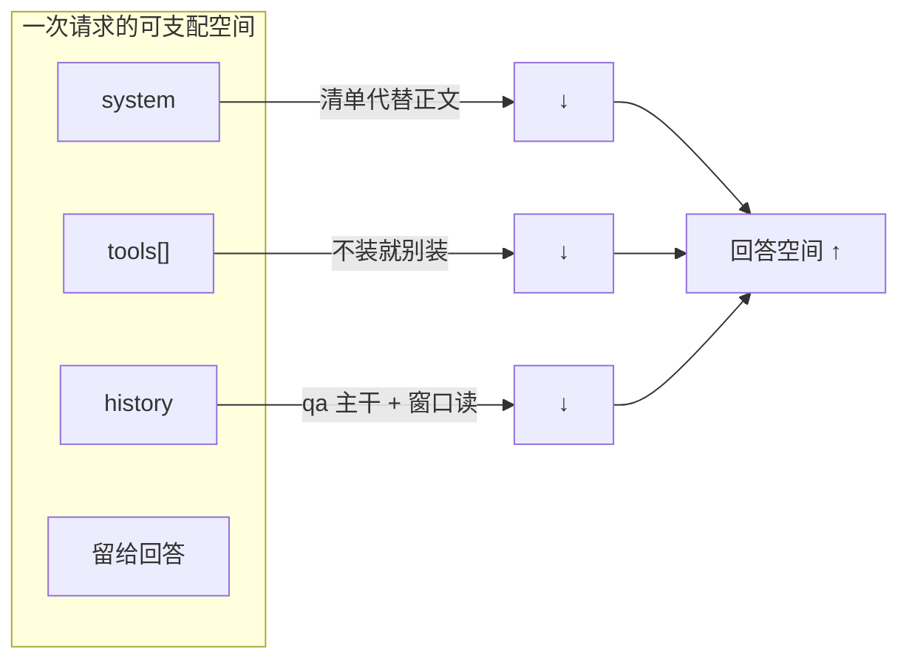
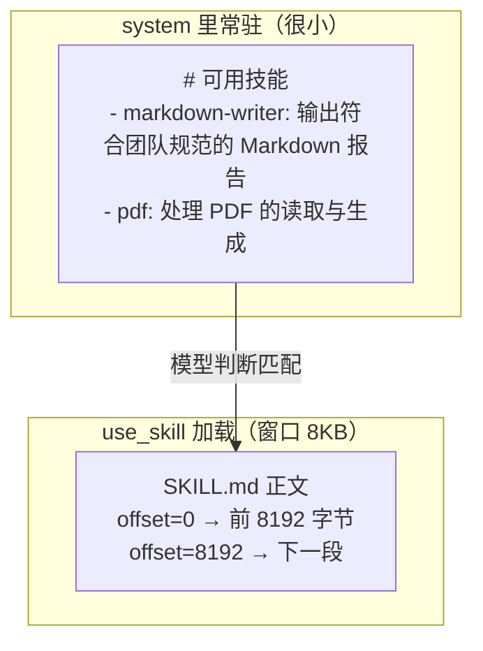

# 10 · 上下文预算

## 10.1 唯一稀缺的资源

模型的上下文窗口是一个固定大小的盒子。每一次请求，你要把四样东西塞进去：

```
┌──────────────────────────────────────────┐
│ system 指令            （固定，含技能清单）  │
├──────────────────────────────────────────┤
│ 工具声明 tools[]        （每个工具 200+)    │
├──────────────────────────────────────────┤
│ 历史 messages[]         (只增不减)         │
├──────────────────────────────────────────┤
│ 本轮留给输出的空间        (max_tokens)      │
└──────────────────────────────────────────┘
```

前三项是成本，第四项是产出。预算不够时，最先被牺牲的总是第四项——`finish_reason=length`，答案被截断。

所以"agent 做得好不好"，很大程度是在回答同一个问题：**每一轮请求里，有多少字节是真正有用的？**



下面四个杠杆，对应这个仓库里的四处设计。

## 10.2 杠杆一：不装的工具不占预算

工具声明的成本容易被低估。一个工具的 `description` + JSON Schema 通常 150~400 字符，20 个工具就是 6000+，而且**每轮都要发**。

最有效的优化不是压缩描述，而是**根本不装**：

```java
// 没配白名单就不装配 http 工具：模型看不到、用不了，也不占 function 定义预算
if (config.httpAccess() != null) {
    fibers.add(ctx.registry.use(HttpPlugin.INSTANCE, ...).await().join());
    fibers.add(ctx.registry.use(HttpTools.INSTANCE, ...).await().join());
}
```

同一个理由支撑了浏览器工具的默认关闭、写文件默认拒绝。这三个决定的表面理由是安全（第十一章），但它们在预算上同样成立：**能力默认不存在，顺便省了它的声明成本**。

顺带一个副作用：工具越少，模型选错的概率越低。这是少数"省钱和省心同向"的优化。

## 10.3 杠杆二：清单常驻，正文窗口读

技能的典型体积是几 KB 到几十 KB。全塞进 system，一次就吃掉大部分预算；完全不塞，模型不知道有它。

所以拆成两半：



三个参数控制成本：

| 配置 | 默认 | 作用 |
|---|---|---|
| `maxDescriptionChars` | 200 | 清单里每条描述的最大长度 |
| `maxLoadBytes` | 8192 | 单次读正文的窗口大小 |
| `maxSkills` | 100 | 最多扫多少个技能 |

清单只写"名字 + 一句话"，让模型能判断"有没有相关的"。真正的正文只有在决定使用后才读，而且**按窗口续读**（`bodySync(name, offset)`），一次 8KB，需要更多就再读一段：

```
[skill: markdown-writer, bytes 0..8192 of 21430]
（正文前 8KB）

[truncated: 13238 bytes left; call use_skill again with name and offset=8192 to continue]
```

这段尾注是设计的一部分：它告诉模型"还有多少、下一步怎么取"，把续读变成模型自己能完成的动作，而不是靠 system 里的说明去教。

这套设计的精髓在于：**把"知道有什么"和"知道具体怎么做"分成两次付费**。前者每次都花（但很小），后者只在用时花一次。

## 10.4 杠杆三：历史只重发问答主干

第九章讲过 `qa` 标记，这里从预算角度看它的效果。

假设每次工具返回 4000 字符、终答 300 字符，跑 5 轮：

| 方案 | 第 5 轮请求体大致构成 |
|---|---|
| 全量重发 | 用户问题 + 5×(工具声明 + 4000 + 300 + assistant) ≈ 22,000+ |
| 只发主干 | 5×(用户问题 + 300) + system ≈ 2,000 |

差一个数量级。而且差距**随轮次线性扩大**——这正是"长会话越跑越慢越贵"的根因。

关键在于这个优化不需要删数据：原文全在库里，只是不再每轮重发。省的是 token，不是信息。

## 10.5 杠杆四：所有读操作都有上限

能力层的每个"读"接口都有硬上限，且**先校验再执行**：

| 接口 | 上限 | 超限行为 |
|---|---|---|
| `read_file` | 默认 30 行，可指定 | 按行窗口返回 |
| `filesystem.readSync` | 2MB | 拒绝 |
| `filesystem.writeSync` | 1MB | 拒绝 |
| `http_get` 响应 | 64KB | 截断并标记 `truncated: true` |
| `browser` 快照 | 无障碍树（数百字符） | 不是 `innerHTML` |

两条设计经验：

**返回"窗口"而不是"结论"。** `read_file` 返回行数组 + `totalLines`，让模型自己决定要不要读下一段。返回一个被悄悄截断的字符串，模型会以为那就是全文。

**截断必须可见。** `http_get` 的响应里带 `truncated` 字段，模型能知道"还有更多"。静默截断会让模型基于不完整信息给结论，而且它不知道自己缺了什么。

浏览器那条最值得单独说：`ariaSnapshot(mode=AI)` 产出的无障碍树是数百字符，`innerHTML` 通常是数万字符。**同样的信息量，两个数量级的成本差**。而且树里每个节点自带 `[ref=e12]`，模型引用 ref 就行，不需要自己编 CSS 选择器——省了 token，也省了出错的机会。

## 10.6 观测：让曲线说话

所有这些优化都有一个共同弱点：**做错了不会报错，只会变慢变贵**。所以要能看见。

`AgentService` 每次 `llm.chat` 前量一次历史：

```java
if (stats) notifyStats(observer, step, measure(history, systemPrompt));
```

`HistoryStats` 按 role 分桶（system / user / assistant / tool），给出字符数。`--debug` 打开后：

- SSE 推 `stats` 帧；
- `final` 帧与一次性 JSON 附带 `requestCharsByStep`（逐次增长曲线）和 `finalRequestChars`。

怎么读这条曲线：

| 现象 | 诊断 |
|---|---|
| 第 1 轮就很大 | 工具声明或 system 太肥 |
| 每轮稳定增长几千 | 正常（问答在累积） |
| 某一轮突然跳 10 万 | 有个工具返回了巨型结果，该加窗口或截断 |
| 增长但 tool 桶占比极高 | 该用 `loadQa` 或减小读窗口 |

这是**运营指标**，不是调试开关。上线后应该常态打开，或者至少定期采样。

## 10.7 一次预算演算

给一个真实的分配参考（字符口径，粗略）：

```
窗口 128K tokens ≈ 400K 字符（英文/代码混排）

system      2,000   （基础指令 + 技能清单）
tools[]     2,400   （8 个工具 × 300）
history    30,000   （qa 主干，够 30 轮对话）
------------------------------------
已用       34,400   （8.6%）
留给输出  365,600
```

看起来很宽裕。但如果没有 `qa` 主干、没有读窗口：

```
history   400,000   （工具原文全量重发）→ 已经爆了
```

结论：**预算不是"窗口够不够大"的问题，是"你往里放了什么"的问题**。换个更大的窗口只是把爆炸推迟几轮。

## 10.8 代价

- **优化会丢信息**。清单代替正文、主干代替全量、窗口代替全文，每一次都在牺牲模型的"知情度"。判断标准是：这个信息模型**现在**需不需要？不需要就别发。
- **多一次工具往返**。按需加载正文，意味着多一轮 `use_skill`。用延迟换预算，在长任务里通常划算。
- **参数要调**。8KB 窗口、64KB 响应、30 行默认——这些数字都是猜的，需要按实际任务 profile 调整。

---

**下一章**：[11 · 安全边界](11-safety.md) —— 能力默认不存在。
