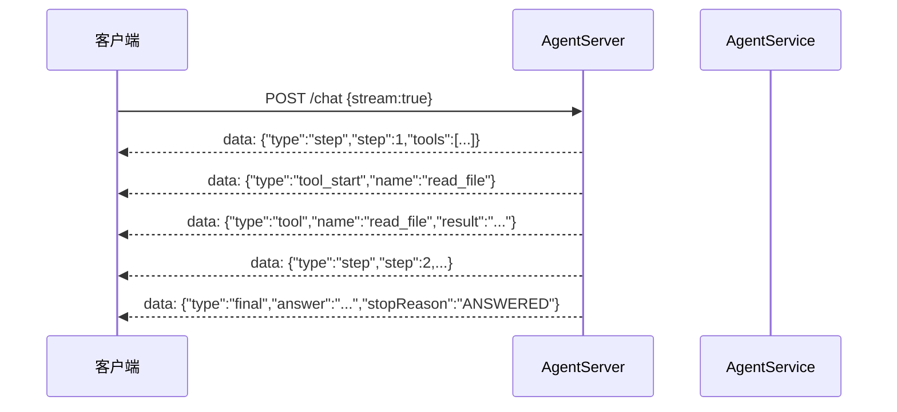
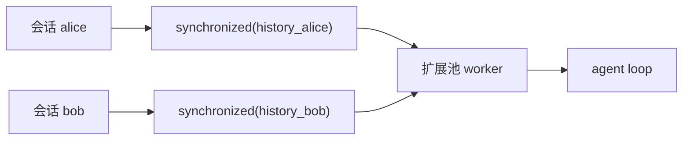

# 12 · 服务化与可观测

## 12.1 装配：把零件装成一个进程

到这一章，所有零件都有了。剩下的事是决定"装哪些、什么顺序、以什么形式暴露出去"。

`AgentServer.start()` 就是这个决定，读起来像一份清单：

```java
ctx = Context.root();
fibers.add(ctx.registry.use(FileSystemPlugin.INSTANCE, ..., null).await().join());
fibers.add(ctx.registry.use(SkillPlugin.INSTANCE, ..., null).await().join());
fibers.add(ctx.registry.use(SqlitePlugin.INSTANCE, ..., null).await().join());
fibers.add(ctx.registry.use(MemoryPlugin.INSTANCE, ..., inject("sqlite")).await().join());
fibers.add(ctx.registry.use(AgentPlugin.INSTANCE, ..., null).await().join());
fibers.add(ctx.registry.use(FileSystemTools.INSTANCE, ..., inject("filesystem","agent.tools")).await().join());
fibers.add(ctx.registry.use(SkillTools.INSTANCE, ..., inject("skills","agent.tools")).await().join());
if (config.httpAccess() != null) { /* HttpPlugin + HttpTools */ }
if (config.browser())            { /* BrowserPlugin + BrowserTools */ }
```

三个要点：

**`.await().join()` 让装配变成显式的顺序。** 第二章说过依赖驱动可以容忍任意顺序，但服务启动最好还是"装好了再往下走"——启动失败要在启动阶段暴露，而不是运行到第三次对话才发现 memory 没起来。

**可选能力用 `if` 包起来。** 没配白名单就没有 http 工具。这不是配置开关，是**装配开关**：不装的东西不存在，模型看不到、不占预算、也没有被误用的可能。

**每个 fiber 都记着。** `fibers` 列表在 `stop()` 时逆序 dispose，整个进程优雅收摊。

## 12.2 接口：四个端点

| 方法 | 路径 | 用途 |
|---|---|---|
| GET | `/health` | 模型、记忆文件、可见工具、技能数、写入策略、会话数、http/browser 状态 |
| POST | `/chat` | `{"session","message","stream"}` → 一次性 JSON 或 SSE |
| POST | `/reset` | 删除该会话的库内历史与内存缓存 |
| POST | `/history` | 回放问答主干（qa=1） |

`/health` 值得单独说：它把**安全状态**和**能力状态**都暴露出来了。

```json
{"model":"gpt-4o","memory":"/ws/memory.db",
 "tools":["read_file","list_dir","grep","use_skill"],
 "skills":3,"write":"deny-all",
 "http":"deny-all","browser":null,"sessions":2}
```

为什么 `write` 和 `http` 要出现在健康检查里？因为最危险的状态是"你以为关着，其实开着"。让它在每次探活时都出现在你眼前。

## 12.3 流式：五种帧



| 帧 | 时机 | 客户端用途 |
|---|---|---|
| `step` | 进入第 n 轮 | 显示"思考中"，并了解本轮可见工具 |
| `tool_start` | 发出工具调用前 | 显示"正在读文件…" |
| `tool` | 工具返回 | 显示结果，或折叠起来 |
| `final` | 终答 | 结束，带 `stopReason` 与 `steps` |
| `error` | 异常 | 展示错误 |

`tool_start` 和 `tool` 分开，是因为它们的时间差可能很长（浏览器渲染好几秒）。没有 `tool_start`，用户会以为卡住了。

`step` 帧带**当前工具快照**，这让前端可以显示"这个 agent 现在能做什么"——热插拔的效果对用户可见。

## 12.4 并发：锁只保护一个东西

agent 服务最容易写错的地方是并发。这里的策略很小：

```java
synchronized (history) {
    // 同一会话：加载 → 跑 loop → 落库 → 收敛为 qa 主干
}
```

- **同一会话串行**：一个会话的两次 chat 不能交错读写历史（否则出现"问题A、问题B、答案B、答案A"）。
- **不同会话真并发**：各持一把 `history` 锁，互不阻塞。
- **过程事件不经过锁**：每次 run 一个 `AgentListener`，天然按次隔离。



对比一下常见的错误做法：给整个 `/chat` 处理器加一把全局锁。那样并发度直接退化为 1，两个用户互相排队等模型——而这把锁本来只需要保护一个 `List`。

## 12.5 落库与内存视图的一致性

这是实现里一个很细但很关键的决策：

```java
private void persist(String session, List<LlmMessage> history, int before) {
    try {
        memory.appendAllSync(session, produced);   // 全文落库
    } catch (RuntimeException e) {
        LOG.warn("persist failed, session={}", session, e);   // 失败不砸响应
    } finally {
        trimToQa(history);      // 无条件收敛为问答主干
    }
}
```

两条规则：

1. **落库失败不影响答案**。答案已经给了用户，不该因为存储故障把整次响应变成 500。
2. **内存视图无条件收敛**。把工具过程行从内存里移除，让内存视图和"从库加载的 `loadQa` 视图"完全一致。

第 2 条的价值在于**消除双份真相**。如果内存里留着工具过程、库里只存主干，那么同一会话在"进程没重启"和"进程重启后"表现就不一样——这种不一致会以"重启后模型变笨了"的形式出现，极难排查。

## 12.6 日志分层

一条原则：**程序输出走 stdout，运行期事件走 slf4j**。

| 输出者 | 通道 | 理由 |
|---|---|---|
| demo 的断言 | stdout | 输出格式就是契约，脚本 grep `[PASS]` |
| CLI | stdout | 它本身就是交互 UI |
| 启动 banner / 参数错误 | stdout / stderr + 非 0 退出码 | 面向人，且要让 shell 判断成功失败 |
| 框架运行期 | slf4j | 输出目标应该由装配方决定，库不该硬编码 stdout |

级别约定也值得抄：

| 级别 | 用在 |
|---|---|
| ERROR | 不可恢复：主循环任务抛出、fiber 挂载失败 |
| WARN | 降级但继续：监听器抛错、事务回滚失败、HTTP 500、浏览器预热失败 |
| INFO | 一次性生命周期事实：workspace 就绪、技能数、driver 启动耗时 |
| DEBUG | 高频诊断：连接建立、临时文件清理失败 |

一个反直觉的点：**"工具执行失败"是 WARN 还是 INFO？** 建议 INFO 甚至 DEBUG——在 agent 里工具失败是常态，会回填给模型自行处理。当成 ERROR 打日志，等于每天给自己制造几千条假警报。

## 12.7 优雅关闭

```java
public void shutdown() {
    mainLoop.shutdown();
    blockingPool.shutdown();
    if (!blockingPool.awaitTermination(5, TimeUnit.SECONDS)) blockingPool.shutdownNow();
    if (!mainLoop.awaitTermination(1, TimeUnit.SECONDS))   mainLoop.shutdownNow();
}
```

为什么不是直接 `shutdownNow`：插件卸载会把"关浏览器/关连接池"这类收尾动作 offload 出去，立刻中断等于在最脆弱的一步把连接掐断——Playwright 会留下脏 node 进程。

顺序也有讲究：先让扩展池收尾（5 秒），再关主循环（1 秒）。因为收尾任务需要主循环来调度。

## 12.8 CLI 与 "会话即字符串"

`AgentCli` 默认走 SSE 逐帧输出，`--resume` 会读回上次的 session id（存在当前目录 `.agent-cli-session`）。

这个设计让"重启进程后继续聊"变得自然：会话的标识不在服务端内存里，而在客户端。服务端只认字符串。因此：

- 服务重启，客户端拿同一个 session 继续，历史从 `memory.db` 读回来；
- 同一用户换个终端，传同一个 session，接着聊；
- 想开新话题，不传 session 就行。

这是"无状态服务 + 有状态存储"的标准形态，代价是**客户端必须自己保管 session id**。

## 12.9 代价

- **一个进程一个 workspace**。多租户需要多进程，或者用 `ctx.isolate` 做更复杂的隔离（当前没做）。
- **同步装配 + `.join()`**。启动时间等于最慢组件的初始化时间（浏览器预热 12 秒）。这是刻意的：宁可启动慢，不要带着半初始化的状态对外服务。
- **没有鉴权**。默认绑 `127.0.0.1`，这是唯一的保护。对外暴露必须先加一层。
- **没有请求队列**。并发上来后，扩展池会排队，客户端看到的是响应变慢而不是 429。

---

**下一章**：[13 · 验证与演进](13-verification.md) —— 怎么证明它是对的。
