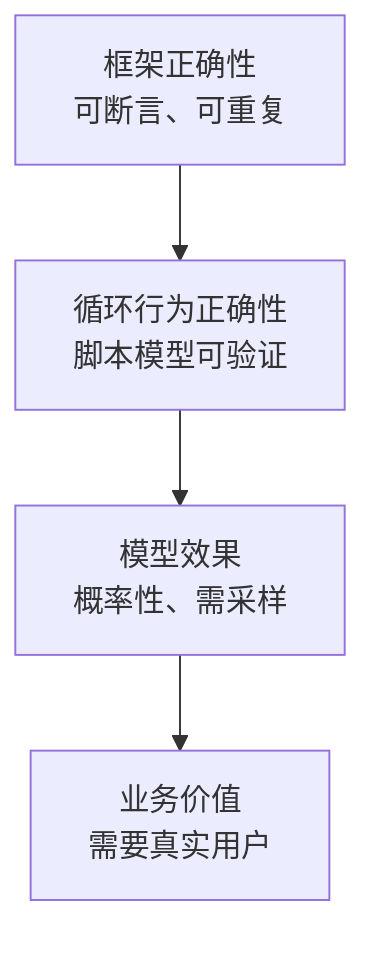

# 13 · 验证与演进

## 13.1 一个 agent 怎么才算"对"

传统服务有明确的验收标准：请求进去，响应出来，字段对得上。agent 没有这个奢侈——同一个输入，模型可能走三条不同的路径，都"合理"。

所以验收要拆成两层：



越往下越不确定。而最容易出致命 bug 的地方，恰恰是最上面两层——那里必须靠断言，不能靠"看起来能用"。

## 13.2 用脚本模型验证循环

这是全书最实用的一个方法论：**在接真实模型之前，先让循环在假模型上跑对。**

```java
/** 按 history 的最后一条消息决定下一步说什么 —— 不联网、不花钱、可断言 */
final class AdaptiveLlm implements LlmClient {
    public LlmReply chat(List<LlmMessage> history, List<Tool> tools, String system) {
        LlmMessage last = history.get(history.size() - 1);
        if (last.role.equals("user") && looksLikeMath(last.content)) {
            return LlmReply.of("", List.of(new ToolCall("call_1", "math", "{\"expr\":\"6*7\"}")));
        }
        return LlmReply.answer("42");
    }
}
```

它能验证的东西比想象中多：

| 想验证的事 | 假模型怎么构造 |
|---|---|
| 基本 loop | 第 1 轮回 tool_calls，第 2 轮回文本 |
| 多工具并发 | 一次回两个 tool_calls，工具里 sleep 出不同延迟 |
| 工具热插拔 | 快照里去掉某工具后，模型仍请求它 → 应回填 `unknown tool` |
| 打满轮数 | 永远回 tool_calls，看是否触发强制收尾 |
| 取消 | 在一个慢工具里 dispose，看是否停在轮间 |
| 流式聚合 | 直接喂 `ToolCallAggregator` 分片，不必真联网 |
| 错误回填 | 工具抛 `RuntimeException`，看历史里的 JSON 是否合法 |

关键认知：**这些行为 100% 由框架决定，与模型质量无关**。把它们验证扎实，接真实模型时剩下的问题就只有"模型选得好不好"，而不是"框架是不是坏了"。

## 13.3 demo 即回归

仓库里没有 JUnit，验证靠 14 个带 `main` 的 demo，每个内含断言：

```bash
CP="target/classes:$(cat target/cp.txt)"
for d in LifecycleDemo TenantDemo HttpDemo SqliteDemo SseDemo AgentDemo MemoryDemo \
         AgentHardeningDemo FsAgentDemo SkillAgentDemo AgentServerDemo HttpToolDemo BrowserToolDemo; do
  java -cp "$CP" cordis.demo.$d > /dev/null 2>&1 && echo "$d ok" || echo "$d FAILED"
done
```

这个选择有争议，但它的理由成立：

- **输出格式即契约**。`[PASS]` / `[FAIL]` 可以被 shell grep，CI 可以只用几行脚本。
- **零依赖**。不需要 surefire、不需要 JUnit，`mvn compile` 之后就能跑。
- **可读性**。一个 demo 就是一个完整的使用示例，比单测更适合教学。

代价也很明确：**没有 IDE 集成、没有覆盖率、失败不会定位到具体断言**。项目变大之后应该换成真正的测试框架，`pom.xml` 里加 surefire 即可。

按重要性排序的 demo：

| Demo | 验证的核心机制 |
|---|---|
| `LifecycleDemo` | 异步调度、慢初始化不阻塞、依赖驱动、effect 逆序 |
| `TenantDemo` | `isolate` 分支隔离 |
| `AgentDemo` | loop、工具热插拔、取消、流式聚合 |
| `AgentHardeningDemo` | 工具异常回填、轮次事务、残缺配对自修复 |
| `MemoryDemo` | 落库、重装后历史仍在、`tool_calls` 往返无损 |
| `HttpToolDemo` | 白名单、重定向逐跳、截断、二进制 |
| `BrowserToolDemo` | open→ref→type→click 闭环、`file://` 拒绝 |

## 13.4 从零实现的顺序

如果让你重写一遍，按这个顺序走，每一步都能独立验证：

**第一步：内核最小闭环。** `Context` + `Fiber`（先只做 PENDING/ACTIVE/DISPOSED 三态）+ `Scheduler`（主循环 + offload）+ `Promise`/`Deferred`。验收：`LifecycleDemo` 跑通。

**第二步：服务解析与隔离。** `provide` / `get` / `isolate` + `inject` 依赖驱动 + effect 逆序。验收：`TenantDemo`。

**第三步：一个能力。** 建议从文件系统开始——它有阻塞 IO、有安全边界，一次把 `applyAsync` 两段式、`*Sync` 断言、沙箱都练到。

**第四步：工具与 loop。** `Tool` + `ToolService` + `AgentService`，配一个脚本模型。验收：`AgentDemo` 前两节。

**第五步：wire 层。** `LlmClient` 接口 + OpenAI 兼容实现 + SSE 聚合。验收：`OpenAiAgentDemo`（需要真实 Key）。

**第六步：记忆。** SQLite + `MemoryService` + `ConversationService`。验收：`MemoryDemo`。

**第七步：服务化。** HTTP + SSE + `/health`。验收：`AgentServerDemo` + curl。

**第八步：可选能力。** HTTP 工具、浏览器、技能。每一个都独立可关，装错了不影响主链路。

这个顺序的原则是：**每一层都能在下一层存在之前被验证**。反过来做（先接真实模型、先做 UI）会得到一堆无法定位的问题。

## 13.5 已知取舍

诚实地列在这里，因为它们决定了这套代码的适用边界：

| 限制 | 影响 | 如果要解决 |
|---|---|---|
| 取消粒度是轮 | "停止"按钮最多多等一次模型往返 | 流式读循环里检查取消标志 |
| 同会话并发 `send` 未串行 | 语义可能交错（`seq` 不会重） | 按 sessionId 加锁，或做 mailbox |
| skill 变更需重装插件 | 没有文件监听 | 加 WatchService，变更触发 reload |
| 提示注入无防护 | 恶意网页可以试图操纵模型 | 权限最小化（当前是唯一的缓解） |
| 浏览器只校验 main frame | 子请求不经过白名单 | 无法彻底解决，靠站点白名单 |
| 未移植 `symbols.intercept` | 不能在本分支覆盖服务配置 | 需要服务侧配合读取分支配置 |
| 无鉴权 | 只绑 127.0.0.1 | 前面加一层网关 |

有一条设计哲学贯穿这些取舍：**宁可缺席，也不提供一个看起来生效、实际没人消费的 API**。`symbols.intercept` 就是这样被砍掉的——它的存在会让读者以为"这个能力是有的"。

## 13.6 往哪里长

几个自然的延伸方向，按投入产出排序：

**一、把 system 组装成中间件链。** 当前 `SystemProvider` 是个函数，加上 waterfall 事件，就能让技能、安全、风格各自追加一段，互不知道对方存在。改动小，扩展性提升明显。

**二、会话级 mailbox。** 解决同会话并发交错，同时为"打断当前 run、插入新指令"打基础。

**三、工具结果的分级截断。** 现在 `http_get` 是硬截断 64KB。更好的做法是"摘要 + 原文落盘 + 按需续读"，和 skill 的窗口模式一致。

**四、审批的异步化。** 现在 `ApprovalGate` 是同步布尔值。真实场景需要"挂起这次调用，等人点确认，超时拒绝"。

**五、观测。** 把 `HistoryStats` 扩成完整的 trace：每轮耗时、每次工具成功率、每类 token 消耗。agent 的可运维性全靠这个。

## 13.7 全书的三个结论

写到最后一章，把能带走的东西压缩成三句话：

**第一句：agent 的复杂度不在模型，在周边。**
一个二十行的 loop 就能跑起来，但要让它跑一个月不出事，需要生命周期、线程模型、持久化、预算、权限五套东西。这个仓库 1.5 万行里，真正属于"agent"的不到 1500 行。

**第二句：所有设计都在回答同一个问题——"下一轮请求里，什么是真正有用的"。**
工具快照是为了让模型看到当下的能力；`qa` 主干是为了不带无关的过程；窗口读是为了不为不需要的正文付费；默认不装工具是为了省掉没用的声明。想清楚这一点，很多取舍就自然了。

**第三句：错误要让能看到它的人看到。**
工具错误给模型看（它可以改道），模型错误给调用方看（人可以重试），框架错误给日志看（运维可以修），权限状态给 `/health` 看（所有人都该知道自己有多大权限）。**把错误塞进错误的通道，是这个领域最常见的失败模式。**

---

回到起点：读完这十三章，你应该能在一张白纸上画出自己的骨架——四个方框（循环、工具、记忆、权限），三条线（依赖、异步、观测），以及每一个方框旁边标着"如果我删掉它，会出什么事故"。

那就是你自己的 agent。
