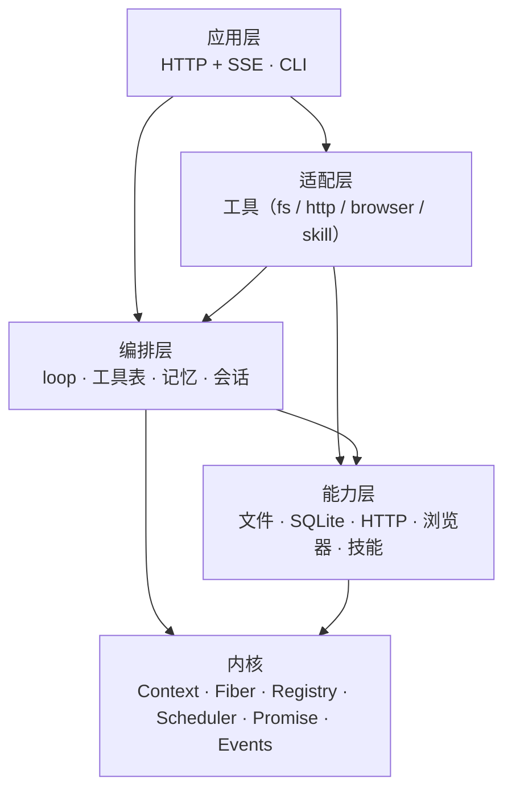

# 从 0 构建一个 Agent

> 以 `cordis-java` 为标本，讲清楚一个可长期运行的 agent 到底由哪些零件构成、每个零件为什么必须长成那个样子。

这套课程不是 API 手册，也不是源码逐行讲解。它的目标是：读完你能在一张白纸上画出自己的 agent 骨架，并知道每一处设计取舍的**代价**在哪里。

## 这套课程怎么读

每一章只讲一个方面，结构统一：

1. **要解决的问题**——不引入这个东西会出什么事故；
2. **原理**——用图和类比讲清机制，而不是贴实现；
3. **最小验证**——几行代码或一条可执行的 demo 命令，证明机制真的成立；
4. **代价**——这个设计放弃了什么。

代码片段都控制在十几行以内，且只用来固定概念，不承担"照着抄就能跑"的职责。真正的实现看仓库本身。

## 目录

| 章 | 主题 | 一句话 |
|---|---|---|
| [01](01-from-call-to-agent.md) | 从一次模型调用到 agent | 模型只会说"我想调用什么"，执行是宿主的事 |
| [02](02-kernel-why.md) | 为什么先要一个内核 | 装配顺序、依赖、回收，不能靠 `new` 的先后顺序来保证 |
| [03](03-thread-model.md) | 主循环与扩展池 | 单线程做决策，多线程干重活，两者之间只走 Promise |
| [04](04-promise-and-events.md) | Promise、Deferred 与事件 | 让"结果回来"这件事有确定的落点 |
| [05](05-capability-layer.md) | 能力层的形状 | 能力不认识 agent，才可能被别的东西复用 |
| [06](06-tool-contract.md) | 工具的契约 | 一半给模型看，一半给框架调 |
| [07](07-agent-loop.md) | agent loop | 全书的核心：一个 for 循环加上四条纪律 |
| [08](08-llm-wire.md) | 模型适配层 | 流式怎么拼，是适配层的事，循环不该知道 |
| [09](09-memory.md) | 记忆与会话 | 会话不是聊天记录，是"下次请求要重发什么" |
| [10](10-context-budget.md) | 上下文预算 | 上下文是唯一稀缺资源，所有设计都在省它 |
| [11](11-safety.md) | 安全边界 | 能力默认不存在，比"存在但受限"更安全 |
| [12](12-serving.md) | 服务化与可观测 | 把 loop 变成一个别人能调用的东西 |
| [13](13-verification.md) | 验证与演进 | 脚本模型先跑通循环，真实模型最后接 |

## 三条推荐路径

**只想搞懂原理**（约 40 分钟）：01 → 07 → 08 → 10。

**准备自己写一个**（约 3 小时）：01 → 02 → 03 → 04 → 06 → 07 → 08 → 11 → 12。

**要维护这套代码**：全线读，重点 02 / 03 / 09，这三章解释了大量"看起来绕"的写法。

## 全景图

依赖方向永远向下。想清楚"这一行代码该属于哪一层"，比写多少行都重要。

## 一句话版本

> agent = 一个 for 循环 + 一份工具清单 + 一段可增长的历史 + 一圈默认关死的权限。
> 循环负责"再试一次"，工具负责"真的做"，历史负责"记得做过什么"，权限负责"别把机器交出去"。

这四件事在这个仓库里分别落在 `AgentService`、`ToolService`、`MemoryService`、`HttpAccessPolicy` / `PathScope` / `ApprovalGate` 上。后面每一章拆一件。
